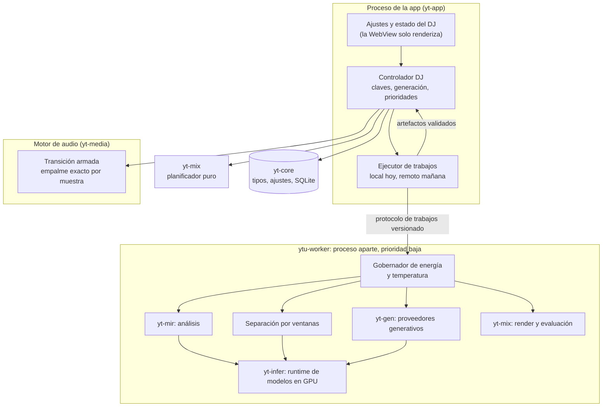

# DJ inteligente

> **Estado:** propuesta de diseño, sin implementar (11 de noviembre de 2026).
>
> **Alcance:** viabilidad técnica, tecnologías evaluadas, arquitectura, latencia, caché, licencias y plan por etapas del
> DJ inteligente de YT Ultimate. Las reglas de [`AGENTS.md`](../AGENTS.md) mandan sobre este documento. Cuando una
> etapa se implemente, su comportamiento pasa a un documento de sistema en `docs/systems/` (en inglés), su estado a
> [`RUST_MIGRATION.md`](RUST_MIGRATION.md), y este documento se actualiza.
>
> **Decisiones del dueño:** en esta versión todo se procesa en el equipo de cada usuario, siempre en la GPU, tanto en
> macOS como en Windows, sin calentar el equipo ni bajar el rendimiento. La arquitectura queda lista para que más
> adelante el mismo trabajo lo haga el servidor del SaaS para muchos clientes.

## 1. Resumen

| Modo | ¿Viable hoy? | Cómo |
|---|---|---|
| Profesional | **Sí, demostrado** en productos (Apple Music AutoMix, djay, Spotify Mix) | Análisis una vez por pista (Beat This!, DSP propio, LinkSeg, EBU R128); 4 stems con HTDemucs en la GPU, solo en las ventanas de transición; plan con curvas de fader y EQ; render previo con Signalsmith Stretch; empalme exacto por muestra |
| Generativo | **En parte.** El remix sin IA (re-secuenciar fragmentos de ambas canciones) es fiable; el puente neuronal es **experimental** | Relleno (*inpainting*) de un hueco de 4–16 compases sobre un lienzo alineado a compases con Stable Audio 3 o ACE-Step 1.5, con los stems instrumentales como contexto, varios candidatos, evaluación automática y el respaldo profesional ya preparado |
| Híbrido | **Sí**, como política sobre los dos | Profesional para pares compatibles; remix o relleno neuronal donde aportan (estilos lejanos con tempo y métrica compatibles); técnicas de DJ para saltos grandes de tempo o métrica |

**Decisiones principales**

1. **Todo corre en el equipo del usuario y en la GPU:** ONNX Runtime con Windows ML (DirectML o el proveedor del
   fabricante) en Windows; ONNX Runtime con CoreML, y candle con Metal, en macOS. El DSP va en CPU con prioridad baja.
   Los Macs Intel y los equipos sin una GPU útil se quedan con mezclas DSP, que no calientan.
2. **Un proceso trabajador aparte,** `ytu-worker`, con EcoQoS o QoS de eficiencia, una sola tarea de GPU a la vez,
   trozos de 50 ms como máximo y un gobernador de energía y temperatura. Ese mismo binario y su protocolo serán el
   trabajador del servidor del SaaS.
3. **Solo se separa lo necesario:** unos 45 s alrededor de cada empalme. HTDemucs cuesta del orden de 35 veces menos
   por segundo de audio que el BS-RoFormer actual.
4. **La música nunca espera:** el clip profesional queda listo antes de intentar algo generativo, y la escalera de
   respaldo termina en el fundido actual.
5. **Derechos por fuente,** con un tipo de dominio que prohíbe por defecto. YouTube necesita una decisión del dueño
   (§7.3).

**Objetivos (a medir en la etapa 0):** ≤ 2 s de GPU por pista nueva; ≤ 10 s de GPU de separación por transición;
20–60 s de GPU por puente generativo; GPU ocupada en promedio ≤ 10 % de cada canción en Profesional y ≤ 30 % con
generación; ningún cambio medible en el hilo de audio.

**Lo más importante:** ningún producto ni artículo demuestra todavía puentes generados con calidad de remix entre dos
canciones comerciales cualesquiera, así que el diseño lo trata como un experimento con evaluación estricta. El mayor
riesgo no es técnico, sino de derechos: las licencias de los pesos de separación y el audio de YouTube, sobre todo si
algún día se procesa en un servidor.

## 2. Punto de partida en el código

| Pieza | Hoy | Papel en el DJ inteligente |
|---|---|---|
| Motor (`crates/yt-media/src/playback.rs`) | Hilo propio dueño del dispositivo. Un deck activo y hasta dos desvaneciéndose, cada uno con su sink, tempo SoundTouch y caché de red | Se conserva. Gana la **transición armada**: empalme exacto por muestra entre A, el clip de transición y B (§5.7) |
| Envolventes (`crates/yt-media/src/crossfade.rs`) | Ganancias por muestra publicadas en un `AtomicU64`, sin bloqueos ni asignaciones por muestra; 1 ms–30 s | Se reutiliza el patrón. Las curvas pasan a `yt-mix` como única fuente para el render y el motor |
| Controlador (`crates/yt-app/src/dj.rs`) | `dj_tick` en el sondeo compartido de 250 ms; abre la siguiente canción en línea 15 s antes; fundido de 1–12 s | Pasa a orquestar: conoce la siguiente canción desde que empieza la actual y programa los trabajos |
| Preferencias (`PlaybackPreferences`) | `dj_mode`, duración, curva y fundir al saltar | `dj_mode` sigue siendo el interruptor. El fundido actual queda como estilo «Clásico» y como último respaldo |
| Separación (`crates/yt-media/src/stems.rs`) | BS-RoFormer de viperx, solo voz/instrumental, ventanas de 8 s. Metal (candle) en Apple Silicon; LibTorch en CPU en Windows | Prueba que ya hacemos inferencia en GPU desde Rust. Pero en esta Mac procesó 18 s de audio en 31,8 s con Metal: demasiado lento y caliente para preparar transiciones. El DJ necesita 4 stems y un modelo más ligero (§4.2) |
| DSP (`crates/yt-quality`) | SoXR HQ, FFT y pico real con sobremuestreo 8× | Remuestreo y medición de pico del render |
| Huella (`docs/FINGERPRINT.md`) | Chromaprint y hash PCM | Identidad de contenido para las claves de caché |

Lo que hoy impide un DJ real:

1. La mezcla empieza cuando el sondeo de 250 ms la detecta: el arranque varía cientos de milisegundos. Un beatmatch
   necesita menos de 10 ms de error.
2. No hay análisis musical: beats, compases, métrica, tonalidad, estructura ni presencia de voz.
3. No hay EQ, filtros ni efectos por deck, y SoundTouch sirve para cambios pequeños de tempo, no para un render de
   alta calidad.
4. La siguiente canción se conoce solo 15 s antes; con aleatorio, se elige en ese momento.
5. La separación actual da dos stems y tarda más que el audio que procesa.

## 3. Qué está demostrado y qué es experimental

| Capacidad | Estado | Evidencia |
|---|---|---|
| Elegir el tipo de transición, beatmatch y estiramiento sobre streaming | Producto | Apple Music AutoMix (iOS 26; solo su catálogo y puede caer a un fundido); djay Automix AI elige los puntos y usa fundido, filtro, EQ, eco, disolución y Neural Mix |
| Transiciones con curvas de volumen, EQ y efectos editables | Producto | Spotify Mix (agosto de 2025, Premium), que además muestra tonalidad y BPM |
| Stems en tiempo real y crossfader por stems | Producto, con archivos propios del DJ | djay Neural Mix y Crossfader Fusion, Serato, VirtualDJ, Traktor 4, rekordbox |
| Stems sobre streaming licenciado | Bloqueado por las licencias | Spotify dentro de rekordbox, Serato y djay (septiembre de 2025) y Apple Music dentro de apps DJ (marzo de 2025), sin stems ni grabación; TIDAL los quitó en 2023 |
| Puntos de cue sugeridos por ML | Producto | rekordbox 7 |
| AutoDJ por cues de intro y outro | Producto abierto | Mixxx 2.3 y posteriores |
| Remixes y mashups licenciados, sin IA | Producto | Hook, con licencia de UMG |
| Creación o remix generativo licenciado dentro de una plataforma | Producto o anunciado | Suno v6 (con WMG, BMG y Believe), ElevenMusic, la plataforma de remixes de UMG con ElevenLabs, Stable Audio 3.0 (datos licenciados, pesos abiertos), Spotify con UMG (previsto para 2027) |
| **Puentes generativos entre dos canciones comerciales cualesquiera** | **Solo investigación** | Ningún producto. DJ-AI (Audio Mostly 2025): puentes con MusicGen y MERT superan a los fundidos; Apple (2023): guía de difusión para construir transiciones entre dos pistas |
| Transiciones y sets planificados con un LLM | Investigación | DJustify (octubre de 2026). Prueba a ciegas con 103 oyentes, escala 1–10: DJ humano 6,7; DJustify 5,6; fundido 4,7 |
| Transiciones automáticas entre 6/8 o 3/4 y 4/4 | Sin precedentes encontrados | Las rejillas del software DJ suponen 4/4 y suelen fallar en 3/4 y 6/8 |

**Conclusión.** El modo Profesional está demostrado: hacerlo bien es ingeniería, no investigación. El motor de remix
sin IA (familia R) imita lo que los DJ latinos ya hacen con *edits* de los DJ pools («Transition», «Acap Out»,
«Reggaeton Intro») y es determinista. Un puente neuronal entre dos canciones concretas es experimental: hay
resultados de investigación prometedores, pero ningún producto lo hace, y por eso aquí siempre lleva evaluación y
respaldo.

**Hallazgos de investigación que fijan reglas del diseño**

- **Cómo mezclan los DJ** (Kim et al., ISMIR 2020; 1 557 mezclas y 20 765 transiciones): el 86,1 % de los cambios de
  tempo son menores al 5 % y el 94,5 % menores al 10 %; solo el 2,5 % de las pistas se transponen, casi siempre un
  semitono; las transiciones y los puntos de salida caen en múltiplos de 32 tiempos, y DJ distintos eligen puntos a
  menos de 8 compases entre sí en el 73,6 % de los casos. Por eso: tono bloqueado siempre, estiramiento de ±5–8 %,
  cues en frases de 32 tiempos.
- **Pocas curvas bastan** (DAFx 2022, 5 040 mezclas): un fader y un EQ de tres bandas por deck reconstruyen mejor las
  mezclas reales; DJtransGAN aprende esas mismas curvas. Una transición profesional es un puñado de curvas tipadas,
  baratas de renderizar y aprendibles más adelante.
- **Lo que más pesa es dónde se corta** (DJustify): buscar cues que respeten la voz y la estructura, y revisar el audio
  renderizado (voz cortada, voces encimadas, huecos de energía, entradas tempranas o tardías) antes de reproducirlo.
- **Los stems resuelven choques mejor que el cambio de tono** (Mosaikbox, ISMIR 2024): quitar los stems incompatibles
  mejora la mezcla. Camelot se usa como puntuación, no como regla dura.
- **Los DJ automáticos funcionan mejor por género** (Vande Veire y De Bie: 91 % de canciones de drum and bass
  analizadas sin errores). Los conjuntos de datos existentes son de electrónica y pop: corridos, reguetón y cumbia
  necesitarán anotaciones propias.

**En generación de audio, en concreto:**

- **Demostrado:** relleno de tramos y continuación dentro de una misma pista con métricas publicadas (Stable Audio 3);
  *repaint* y *lego* como funciones publicadas (ACE-Step 1.5); generación en segundos en equipos de consumo.
- **Solo investigación:** transiciones entre dos pistas con guía de difusión (Apple, 2023); puentes con continuación de
  MusicGen y MERT que superan a un fundido en la prueba de sus autores (DJ-AI, 2025); relleno de huecos largos con SimDPS
  (ISMIR 2026).
- **Sin demostrar:** puentes con calidad de remix entre canciones cualesquiera. El mejor planificador de 2026
  (DJustify) no usa audio generado.

## 4. Tecnologías evaluadas

Criterios: calidad musical, capacidad de trabajar con el audio existente, fidelidad a las canciones, latencia,
hardware, posibilidad de procesar por adelantado, licencias, viabilidad de integración en Rust y capacidad de
producir transiciones cortas y coherentes. Lo marcado «por verificar» necesita una prueba en la etapa 0.

### 4.1 Análisis musical

El análisis es barato: alrededor de 1 s por minuto de audio incluso en CPU, menos en GPU. Se hace una vez por pista y
se guarda.

| Necesidad | Elección | Calidad y costo | Licencia | Notas |
|---|---|---|---|---|
| Beats y tiempos fuertes | **Beat This!** (ISMIR 2024), crate `beat-this` o su ONNX con `ort` | F1 en GTZAN: beats 89,1 y tiempos fuertes 78,3 (modelo pequeño: 88,8 y 77,2). 20 M o 2 M parámetros; una pista de 4:32 en 4,6 s en la CPU de un M4 | MIT, código y pesos | No trae un modelo de métrica: la rejilla y la métrica las ajusta nuestro DSP |
| Rejilla, tempo y métrica | DSP propio en `yt-mir` sobre la activación de Beat This! | Métrica por el espaciado de los tiempos fuertes; binaria o ternaria por la periodicidad de la activación; rejilla de tempo por tramos para grabaciones en vivo | Nuestra | El 3/4 y el 6/8 solo coinciden en el tiempo fuerte, y ahí falla el software DJ actual |
| Estructura | **LinkSeg** (ISMIR 2024), ONNX de 1,5 MB | 7 etiquetas; precisión de 0,747 en RWC-Pop | CC BY 4.0 según el port ONNX; el repositorio original no tiene licencia (por verificar) | Cues en frases de 8 o 16 compases ajustadas a sus fronteras; «drop» = coro o instrumental con salto de sonoridad |
| Tonalidad | Croma propio con perfiles de tonalidad; después, una CNN estilo S-KEY reentrenada con audio licenciado | Perfiles clásicos ≈ 53 % en FMAKv2; S-KEY ≈ 72–74 % (MIREX ponderado) | Código de S-KEY MIT, pesos solo para investigación | Con confianza; se usa como puntuación |
| Voz | Energía del stem de voz en la ventana separada | — | — | Sin stems, una estimación espectral sencilla |
| Sonoridad y energía | `ebur128` | EBU R128 integrada, de corto plazo y momentánea, LRA y pico real | MIT | |
| Estilo | LAION-CLAP | — | Apache-2.0 según su ficha (por verificar) | MERT y MuQ son no comerciales |

Descartados: madmom (modelos CC BY-NC-SA), Essentia (AGPL, modelos no comerciales), libKeyFinder (GPL), SongFormer
(depende de pesos de MuQ no comerciales) y los acordes por ahora (BTC no declara licencia de pesos). All-In-One separa
la canción entera antes de analizar: es una opción para el servidor.

**Géneros propios.** Los conjuntos de datos públicos son de electrónica y pop. Adaptar un tracker de beats a métricas
latinoamericanas necesitó solo minutos de anotación en la literatura, y Beat This! se ha ajustado con éxito a otras
tradiciones. Plan: anotar de 100 a 200 pistas de corridos tumbados, reguetón y cumbia para validar y, si hace falta,
ajustar el modelo (su licencia MIT lo permite).

### 4.2 Separación

La separación es lo único caro del modo Profesional, así que solo se separan unos 45 s alrededor de cada empalme.

| Modelo | Calidad (SDR) | Velocidad medida | Ports | Licencia de pesos y datos | Decisión |
|---|---|---|---|---|---|
| **HTDemucs v4**, un solo modelo con 4 stems (~41 M parámetros) | 9,0 dB en MUSDB18-HQ | M1 Pro con MLX: una canción de 3:13 en 8,5–9,3 s con 1,2 GB. M4 Max, 120 s de audio: 1,05 s con MLX, 2,82 s con MPS, 19,4 s en CPU. RX 7600 con ONNX: 22× el tiempo real, 8× dosificado | ONNX, Core ML y MLX; en Rust, `stem-splitter-core` (ort con CoreML, DirectML o CUDA) y `demucs-rs` (Burn) | Código MIT. Licencia de pesos no declarada; entrenado con MUSDB18-HQ y 800 canciones; repositorio archivado | **Predeterminado**, sujeto a la revisión legal de sus pesos |
| SCNet-S (10 M) | 9,0 dB | La mitad del tiempo de CPU de HTDemucs | Sin ONNX ni Core ML | Código MIT, pesos de MUSDB | Candidato si se porta |
| BS-RoFormer de viperx (el actual) | Voz 10,87 dB | 0,57× el tiempo real en esta Mac con Metal | candle Metal (en el árbol); ONNX posible | MIT solo «afirmada» por UVR; datos sin documentar | «Voz HD» opcional en GPU rápidas, cuando la voz queda expuesta (una acapella) |
| SDK comerciales: AudioShake Local Inference, Music.AI Embedded | Comercial | macOS arm64 y x86_64 (Metal, Neural Engine), Windows x64 y ARM64 (DX12, CUDA) | SDK nativo | Licencia limpia; Music.AI dice entrenar solo con material licenciado; acceso por solicitud y precio privado | Alternativa si la revisión legal descarta los pesos abiertos |

Descartados: Mel-Band RoFormer de Kim (228 M parámetros, licencia contradictoria), Open-Unmix (pesos CC BY-NC-SA),
Spleeter (5,9 dB) y los modelos de tiempo real (4,7–5,2 dB).

- **Por qué HTDemucs.** Da 4 stems por pasada a unas 21 veces el tiempo real en un M1 Pro, mientras que el modelo
  actual da un stem a 0,57×: del orden de 35 veces menos costo por segundo de audio (son chips distintos; es un orden
  de magnitud). Cambiar de runtime al modelo actual daría de 2 a 3 veces, no 30. Tiempo estimado por ventana de 60 s:
  M4 Max ≈ 0,5 s, M1 Pro ≈ 3 s, M1 o M2 base ≈ 5–10 s, RTX 3060 o 4060 ≈ 2–4 s.
- **Cómo se usa.** Precisión mixta, poco solapamiento y 2–4 s de contexto extra en los bordes de cada ventana. En el
  Neural Engine el fp16 completo degrada los stems de batería y bajo si las convoluciones no quedan en fp32: se valida
  la calidad por stem. El cuarto stem se construye como residuo (mezcla menos los otros tres), como hoy el instrumental: con todas
  las ganancias en 1 la suma reconstruye exactamente el original, así que los artefactos solo pueden oírse donde la
  transición cambia la ganancia de un stem.
- **Trozos dosificados.** Partido en 21 envíos de 10–30 ms, HTDemucs mantuvo la interfaz a 30 FPS en una RX 7600; en
  una sola ejecución bajó a 12–18 FPS con congelamientos de 330 ms. De ahí la regla de trozos cortos del gobernador.
- **El bloqueo es la licencia, no la velocidad.** MUSDB18 y MoisesDB solo permiten uso académico o de investigación
  no comercial, y ningún peso abierto de buena calidad tiene una licencia comercial limpia. Opciones: revisión legal
  de los pesos abiertos, un SDK comercial o, en la fase SaaS, entrenar un modelo propio con stems licenciados.

### 4.3 DSP: estiramiento, remuestreo, sonoridad y decodificación

El DSP corre en CPU con prioridad baja: una transición cuesta milisegundos y en la GPU costaría más energía.

| Necesidad | Elección | Licencia | Notas |
|---|---|---|---|
| Estiramiento y cambio de tono del render | **Signalsmith Stretch** (crate `signalsmith-stretch`) | MIT | Su mejor rango es de 0,75× a 1,5×, que cubre el beatmatch |
| Alternativa | Bungee (`bungee-rs`) | MPL-2.0 | Granular, cualquier velocidad; el binding de Rust aún es inmaduro |
| Descartadas | Rubber Band R3; zplane élastique | GPL o licencia comercial de pago; comercial sin binding de Rust | La app es propietaria |
| Tempo en tiempo real (respaldo) | SoundTouch, ya en uso | LGPL-2.1, enlazado de forma estática | Solo hasta ±3 %. Revisar las obligaciones de reenlace de la LGPL, como ya se hace con SoXR en `yt-quality` |
| Remuestreo | SoXR (ya en `yt-quality`) o rubato 5 | LGPL-2.1; MIT/Apache | `process_into_buffer` de rubato no reserva memoria |
| Sonoridad | `ebur128` | MIT | Sonoridad integrada y de corto plazo EBU R128 |
| FFT y EQ | `rustfft`/`realfft` (en uso), `biquad` | MIT/Apache | |
| Decodificación | Symphonia con libopus (en uso) | MPL-2.0; BSD | Symphonia no hace *gapless* en MP4 ni MKV: hay que recortar nosotros el retardo de Opus y las *edit lists* de AAC, y decodificar al menos 80 ms antes de cada punto de seek (RFC 7845). Es la base de la alineación de empalmes (§5.7) |

### 4.4 Generación de puentes

**El enfoque más coherente hoy es el relleno entrenado de un tramo (*inpainting*) sobre un lienzo alineado a
compases:** [cola de A | hueco | cabeza de B], estirados a un mismo BPM y cortados en tiempos fuertes. El modelo oye las
dos canciones y solo rellena el hueco, así que el puente nace con continuidad hacia ambos lados en vez de ser música
independiente. Un hueco de 16 s necesita unos 40 s de lienzo, y el costo crece con el lienzo, no con el hueco.

| Modelo | Qué hace | ¿Oye ambos lados? | Control de tempo, métrica y tonalidad | Calidad publicada | Licencia y datos | Memoria | Tiempo en equipos de consumo | Runtimes |
|---|---|---|---|---|---|---|---|---|
| **Stable Audio 3 Medium** (1,4 B, mayo de 2026) | Relleno de uno o varios tramos, continuación, audio a audio | Sí: entrenado con máscaras de 1 a 10 tramos | Ninguno; el BPM solo va en el texto | FAD de relleno 0,046 y de continuación 0,074 | Código MIT. Pesos con la licencia comunitaria de Stability: gratis por debajo de 1 M USD de ingresos anuales (con afiliadas), registro, aviso «Powered by Stability AI», y un servicio alojado cuenta como uso comercial. Codificador T5Gemma con los términos de Gemma. **Datos licenciados**: AudioSparx y Freesound CC | 3,8–5,2 GB con MLX | Medido con MLX: M1, 10 s en ~5 s; M4 Pro, 30 s en 5,1 s. Lienzo en un M1: ≈ 12–20 s (estimado) | MLX en Apple Silicon; TFLite en CPU. **Sin ruta de GPU en Windows** |
| **Stable Audio 3 Small-Music** (433 M) | Igual | Sí | Igual | FAD de relleno 0,100 | Igual | 0,8–1,6 GB | Medido: M1 con MLX, 10 s en ~1 s; Core ML, 30 s en 0,63 s | MLX, Core ML, TFLite |
| **ACE-Step 1.5** (2 B; versión XL de 4 B desde abril de 2026) | *Repaint* en todas las variantes, *cover* y *extract*; *lego* (añade batería, bajo o sintes en el contexto) y *complete* solo en el modelo base | Sí: tareas de fuente más máscara | Metadatos de BPM (30–300), tonalidad y compás (2/4, 3/4, 4/4 y **6/8**), aunque no está comprobado que el *repaint* los respete | Audiobox PQ 8,35 (autoinformado); sin métricas de *repaint* | Código y pesos MIT. Dice usar datos licenciados, libres de regalías y MIDI sintetizado, pero su artículo no nombra las fuentes: **procedencia no verificable** | 4,7 GB en bf16; en GGUF Q8, 2,4 + 0,3 + 0,75 GB | Medido en una M4 Pro con un lienzo de 48 s: DiT 3,5 s por candidato y 41 s con el VAE, sin optimizar (§8.1). Estimado en RTX 3060 o 4060: 2–5 s de DiT. *Lego* cuesta unas 10 veces más | `acestep.cpp` (MIT): Metal, Vulkan, CUDA y CPU, con las seis tareas |
| **Magenta RealTime 2** (230 M o 2,4 B, junio de 2026) | Flujo en tiempo real guiado por texto, embeddings de estilo y notas MIDI | **No**: el audio solo fija el estilo | Notas MIDI; sin BPM ni tonalidad | — | Código Apache-2.0, pesos CC BY 4.0; ~71 000 h de música de stock, casi toda instrumental | Ligero (small) | Tiempo real en cualquier M-series (small) | MLX y C++, solo Apple |

**Descartados:** MusicGen, MusicGen-Style, JASCO, MAGNeT y sus derivados (pesos CC-BY-NC), VampNet (CC BY-NC-SA) y
YuE2 (CC BY-NC); MusicGen-Stem, Diff-A-Riff, DITTO, SingSong, StemGen, Music ControlNet y Seed-Music (sin pesos o sin
código públicos); DiffRhythm 2, HeartMuLa y SongBloom (canciones completas, sin relleno); Stable Audio Open 1.0 y Small
(superados por Stable Audio 3); y los servicios solo en la nube (Lyria RealTime tiene BPM y tonalidad pero no acepta
audio; ElevenLabs Music; Suno v6 sin API pública; Udio cerrado), que además obligarían a enviar el audio del usuario.
MuseControlLite, un adaptador de 85 M que añade control de ritmo y melodía a Stable Audio Open, es la plantilla para un
futuro adaptador de rejilla sobre Stable Audio 3.

**Receta del puente neuronal**

1. **Puerta.** Solo se intenta si el tempo está a ±6 % o en relación 2:1, la familia métrica es la misma, la distancia
   de Camelot entre A y B es ≤ 1 (el hueco no cambia de tonalidad de forma fiable), no hay voz principal en los
   compases junto a las costuras, y el nivel del equipo y la tasa de aprobación de ese género lo permiten. Para saltos
   grandes de tempo o de métrica, las técnicas de DJ (corte en frase con eco, solo stems sin percusión sobre la batería
   de B, modulación métrica) son más fiables que un modelo.
2. **Lienzo.** 8 compases de contexto a cada lado y un hueco de 4, 8 o 16 compases, todo en tiempos fuertes. El
   contexto son los stems instrumentales de la separación profesional, para que el modelo no invente voces.
3. **Indicación.** Género, instrumentos, «N BPM», tonalidad e «instrumental, DJ build»; en ACE-Step, también sus
   metadatos.
4. **Guía opcional (sin probar).** Una mezcla DSP de la batería de A y el bajo de B colocada en el hueco, procesada con
   audio a audio de fuerza moderada, para fijar la rejilla y la armonía.
5. **Candidatos.** De 2 a 4 en el equipo (8 en el servidor); gana el que mejor pasa la evaluación (§4.6).
6. **Empalme.** Solo el hueco se inserta en el render profesional, con fundidos de potencia constante de un tiempo
   como máximo y sonoridad igualada. Las canciones nunca pasan por el códec del modelo, y la voz real de A puede volver
   sobre el hueco («remix puente»). Medido: `acestep.cpp` ya devuelve el original intacto fuera del hueco (§8.1).

**Actualización del 12 de noviembre de 2026.** Desde octubre de 2026 existe `sa3.cpp`
([repositorio](https://github.com/betweentwomidnights/sa3.cpp)), un port comunitario de Stable Audio 3 a C++ y GGML
(código MIT) que corre en Metal, Vulkan, CUDA, HIP y CPU. Tiene una API C con texto a audio, audio a audio y relleno
(`--init` con `--inpaint-start`/`--inpaint-end`) y una cancelación cooperativa (`should_cancel`). Ya hay un VST3 y una
extensión de Ableton para Windows construidos sobre él. Esto cierra el hueco de Windows de esta sección.

- **Tiempos publicados** (no medidos aquí):
  - Medium F16, 12 s de audio con la carga del modelo: 3,5 s en CUDA y 4,1 s en Vulkan en una RTX 5070 de portátil
    (unos 6 GB de VRAM); 6,2 s en Metal en una M4 Air sin ventilador.
  - En una iGPU de Intel con Vulkan tarda 23,5 s, así que los equipos G1 siguen sin generación.
- **Tamaños.** Medium F16 ronda 5,7 GB. Small-Music (DiT + SAME-S) pesa 1,08 GB en F16, 591 MB en Q8 y 384 MB en Q4_K_M.
- **ACE-Step 1.5** sigue siendo la alternativa con metadatos de BPM y tonalidad, pero sus datos son de procedencia menos
  clara.
- **Lo demás sigue sin servir para un puente entre dos canciones:**
  - Magenta RT2: el audio solo fija el estilo.
  - HeartMuLa: ahora Apache-2.0, pero sin relleno.
  - YuE2 y AudioCraft: pesos no comerciales.
  - Los repositorios de SongBloom e InspireMusic se retiraron.

**Recomendación nueva (implementada el mismo día como fusiones, §8.0):** Stable Audio 3 Medium con `sa3.cpp` en las dos plataformas, con un solo runtime para Metal y
Vulkan (CUDA opcional).

- **Ejecución.** Va dentro de `ytu-worker`, cargado bajo demanda por FFI.
- **Lienzo.** Se arma con los stems instrumentales: [cola de A | hueco | cabeza de B], en tiempos fuertes a 44,1 kHz.
- **Candidatos.** Cada uno es un relleno de 8 pasos sin CFG con su propia semilla. Solo el hueco se empalma.
- **Precisión.** F16 en Metal, porque cuantizar no lo acelera ahí. Q8 o Q4_K_M en GPU de Windows con 6–8 GB.
- **Equipos pequeños.** Small-Music solo en Macs de 8 GB, con una puerta más estricta.
- **Costo estimado** (sin medir) en la M4 Pro: unos 6–10 s de GPU por candidato con un lienzo de 24–48 s, unas 10 veces
  menos calor que ACE-Step (§8.1).

**Decisiones pendientes del dueño:**

- **Licencia comunitaria de Stability.** Es gratis por debajo de 1 M USD de ingresos anuales con afiliadas, exige
  registro y el aviso «Powered by Stability AI», y por encima de ese umbral el SaaS necesita una licencia empresarial
  que Stability concede a su criterio. Además, la demanda *Anders v. Stability AI* sobre los datos de AudioSparx sigue
  pendiente.
- **Runtime en C++.** Es una pieza que no está en Rust, mantenida por una sola persona y sin versiones etiquetadas: hay
  que fijar un commit y probarlo contra PyTorch.
- **Descarga.** El modelo pesa unos 5,7 GB y se baja bajo demanda.

Los puentes sintetizados en Rust se quitaron el 12 de noviembre de 2026, porque al dueño le sonaban mal y no encajaban
(§8.0). Mientras no haya modelo, ningún estilo genera audio.

**Decisión por plataforma (etapa 5, antes de `sa3.cpp`)**

- **macOS con Apple Silicon y 16 GB o más:** Stable Audio 3 Medium con MLX en la GPU, como proveedor principal por sus
  datos licenciados y sus métricas publicadas de relleno. Hay que llevar su inferencia a Rust con la API C de MLX: la app
  no distribuye Python.
- **Macs de 8 GB:** sin generación neuronal por defecto; Stable Audio 3 Small-Music con Core ML se mide en la etapa 0.
- **Windows:** Stable Audio 3 no tiene ruta de GPU, y en CPU calentaría. Dos caminos: ACE-Step 1.5 turbo con
  `acestep.cpp` en Vulkan o CUDA (hoy la única ruta de GPU para NVIDIA, AMD e Intel, pero exige revisar antes la
  procedencia de sus datos) o una exportación propia de Stable Audio 3 a ONNX con DirectML. Mientras tanto, en Windows
  el modo Generativo usa solo la familia R.
- **ACE-Step en Mac** queda como alternativa por género, elegida con pruebas A/B; su *lego* (modelo base) solo en GPU de
  12 GB o más, o en el servidor.
- **Magenta RT2** se revisa cuando acepte audio; antes, su control MIDI podría dar pads afinados en Mac.

**Riesgos propios.** Stable Audio 3 no se condiciona por rejilla, métrica ni tonalidad: puede derivar de tempo o
deslizar la fase (lo filtran la puerta y la evaluación). Los corridos, el reguetón y la cumbia probablemente están poco
representados en los datos de stock: se mide por género, y Stable Audio 3 admite LoRA (también con MLX) para ajustarlo
después con material licenciado. El paso por el códec suaviza los transitorios: un hueco puede sonar menos producido que
las canciones masterizadas. La descarga de Stable Audio 3 para MLX ronda 8,4 GB: va bajo demanda con su manifiesto.

### 4.5 Runtimes de GPU en el equipo del usuario

| Plataforma | Elección | Por qué | Descartado |
|---|---|---|---|
| macOS, Apple Silicon | **ONNX Runtime con CoreML** (crate `ort`) para análisis y separación, con el mismo ONNX que Windows y el servidor. Se valida en la etapa 0 contra Core ML nativo (`objc2-core-ml`) y un port a candle, porque CoreML no garantiza ejecutar el modelo entero en la GPU o el Neural Engine. **candle con Metal** para el BS-RoFormer que ya existe (`vendor/candle-roformer-metal`) | Un solo artefacto por modelo en las tres plataformas; candle ya corre RoFormer en la GPU desde Rust | LibTorch MPS (falla con los float64 del modelo actual); MLX para análisis y separación (otro runtime, solo Apple Silicon, bindings no oficiales) |
| macOS, Intel | Sin modelos por defecto: DSP solamente | Los kernels de candle usan instrucciones de matrices de las GPU de Apple, y ONNX Runtime dejó de publicar binarios x86_64 para macOS desde la 1.24.1 | — |
| Windows | **ONNX Runtime a través de Windows ML** (crate `ort`) | DirectML funciona en cualquier GPU DX12 (NVIDIA, AMD, Intel) desde Windows 10. En Windows 11 24H2 o posterior, Windows descarga los proveedores del fabricante (TensorRT-RTX en RTX 30xx o posterior, AMD en RDNA 3 o posterior, OpenVINO en Intel) sin que la app los incluya | Incluir CUDA o LibTorch CUDA (de 1,9 a 2,9 GB por paquete); burn/CubeCL (aún en alfa); tract (solo CPU) |
| Generación (etapa 5) | MLX en Mac para Stable Audio 3; `acestep.cpp` (GGML con Metal, Vulkan o CUDA) para ACE-Step | Son las rutas oficiales o maduras de esos modelos (§4.4) | Python empaquetado dentro de la app |
| Servidor (después) | ONNX Runtime con CUDA o TensorRT, o candle con CUDA | El mismo ONNX que Windows o el mismo port de candle que macOS | TorchServe (archivado en agosto de 2025) |

- **Pocos runtimes.** ONNX Runtime para todo lo que se pueda exportar a ONNX; candle solo para el RoFormer existente;
  MLX y GGML solo para la generación, dentro del trabajador y como descargas opcionales.
- **Un modelo, un artefacto.** De cada checkpoint de PyTorch sale, con un script reproducible, su ONNX (y safetensors
  cuando lo usa candle). Cada backend tiene una prueba de paridad (diferencia máxima o de SDR) contra una referencia en
  CPU.
- **Exportar para la GPU sin perder calidad.** El script de exportación reescribe con matemática exacta lo que CoreML
  manda a la CPU (cortes vacíos, `Neg`, `ReduceL2`, `Gather` de la atención, `BatchNorm` sin plegar). Con eso Beat
  This! pasó a ejecutarse entero en la GPU con 130 veces menos CPU y el mismo resultado (§8.1).
- **Una interfaz estrecha por tipo de modelo** (por ejemplo «procesa N ventanas de espectrograma y devuelve las
  máscaras»), implementada con ONNX Runtime (CoreML en macOS, Windows ML en Windows y, más adelante, CUDA en el
  servidor) y con candle-Metal para el RoFormer. La STFT, el solapamiento y la cancelación quedan en Rust común, como
  hoy.
- **Medido en macOS (§8.1):** HTDemucs corre en la GPU con ONNX Runtime y CoreML (1 449 de 1 500 nodos) y da el
  mismo resultado que la CPU; Beat This! necesita una exportación sin cortes vacíos para no caer a la CPU.
- **Primera prueba técnica en Windows:** cargar el ONNX Runtime de Windows ML desde `ort` y registrar sus proveedores
  del catálogo. Respaldo comprobado: ONNX Runtime 1.24.4 con DirectML.
- **Reglas de DirectML:** una ejecución a la vez por sesión, y permite pasarle nuestra propia cola de D3D12.

**Niveles de capacidad**, elegidos con la memoria de GPU medida (Metal `recommendedMaxWorkingSetSize`; en Windows,
el presupuesto de `QueryVideoMemoryInfo`):

| Nivel | Equipos | Trabajo local |
|---|---|---|
| G3 | Apple M-series Pro o Max con 32 GB o más; GPU dedicada con 12 GB o más y proveedor del fabricante | Todo, incluida la capa neuronal con ACE-Step base (*lego*), con cargador |
| G2 | Apple M-series con 16 GB o más; GPU dedicada con 6 GB o más y proveedor del fabricante | Análisis, stems de ambas ventanas, remix y relleno neuronal (Stable Audio 3 Medium en Mac; ACE-Step turbo en Windows), con cargador |
| G1 | Macs de 8 GB, GPU integradas, GPU de 4 GB o solo DirectML | Análisis y stems de la ventana de salida, solo con cargador; sin generación neuronal |
| C0 | Macs Intel, sin DX12, adaptador por software o modos de bajo consumo | DSP y mezcla en tiempo real, sin modelos pesados |

### 4.6 Evaluación automática y pruebas de escucha

**Puerta automática.** Cada clip se evalúa en el trabajador antes de armarlo. Es determinista, barata y local. Los
umbrales iniciales se calibran con el conjunto de escucha en las etapas 0 y 2.

| Comprobación | Umbral inicial | Aplica a |
|---|---|---|
| Fase de beats en el solapamiento y en los empalmes (Beat This! pequeño sobre el clip) | p95 ≤ 10 ms y sin saltos de tiempo fuerte | Todas |
| Sonoridad de corto plazo | Salto ≤ 2 dB en cada empalme; trayectoria a ±1 LU de la planificada | Todas |
| Pico real | ≤ −1 dBTP, sin recorte | Todas |
| Voz encimada o cortada | 0 s de dos voces a la vez salvo una técnica de mashup; ninguna frase cortada a la mitad | Todas desde la etapa 3 |
| Choque de bajos | Energía por debajo de 150 Hz de las dos canciones a la vez, bajo el umbral | Todas |
| Huecos de energía y entradas tempranas o tardías | Según la trayectoria de energía del plan | Todas |
| Tempo del tramo generado | ±1 % del objetivo | N |
| Tonalidad del tramo generado | Su croma coincide con la tonalidad objetivo o su relativa, y correlaciona con los compases vecinos | N |
| Costuras | Sin picos de flujo espectral; similitud LAION-CLAP entre ventanas vecinas sobre el umbral | N |
| Calidad estética | audiobox-aesthetics (CC BY 4.0): PQ y CE no menores que los de las ventanas de A y B, menos un margen | N |
| Fallos típicos | Voz generada (energía del stem de voz del tramo), silencio, bucle atascado, recorte | N |

Las tasas de aprobación se guardan en local por técnica, género y equipo, y alimentan la política del modo Híbrido.
Nada de eso sale del equipo.

**Pruebas de escucha.** A ciegas y en orden aleatorio, con escala de 1 a 10, como DJustify. Anclas: el fundido clásico
abajo y, en un subconjunto, una transición hecha a mano por un DJ arriba. Se reporta la diferencia media con un
intervalo de confianza bootstrap del 95 % y una prueba de permutación pareada por par de canciones. MUSHRA
(ITU-R BS.1534) para comparar variantes finas de una misma técnica.

### 4.7 Servidor del SaaS (fase posterior)

- **Servicio de modelos:** trabajadores Rust con ONNX Runtime (CUDA o TensorRT). Python solo para modelos generativos
  que únicamente existan en PyTorch, detrás de un servidor de inferencia (Dynamo-Triton, Ray Serve o BentoML).
- **Cola:** tabla de Postgres con `UNIQUE(job_key)` e inserción sin duplicados, de modo que un trabajo idéntico pedido
  por muchos usuarios corre una sola vez. Los trabajadores reclaman con `FOR UPDATE SKIP LOCKED`, ordenados por
  prioridad y fecha límite, con arrendamiento y latido. Reparto justo entre clientes con tiempo virtual por cliente.
  Expropiación solo entre trozos. El control de admisión rechaza lo que no llegaría a tiempo, y entonces el cliente
  usa su camino local. NATS JetStream es la alternativa cuando haga falta más escala.
- **Escalado:** KEDA escala los grupos de GPU con una consulta a Postgres o con el retraso de la cola.
- **Entrega:** clips Opus en almacenamiento de objetos con CDN. Cloudflare R2 cobra 0,015 USD por GB-mes y no cobra
  salida; un clip de 30 s a 128 kb/s pesa unos 0,48 MB.
- **Precio por hora de GPU bajo demanda (USD):** L4 de 0,44 a 0,81; A10G de 1,01 a 1,10; A100 80 GB de 1,19 a 2,72;
  H100 de 1,99 a 6,88, según el proveedor (AWS, GCP, Modal, RunPod).
- **Costo estimado por cada 1 000 transiciones:** separación de 90 s de audio por transición a unos 0,1 s de L4 por
  segundo de audio: de 1,7 a 3,4 USD con un 50 % de aciertos de caché; render y almacenamiento, unos 0,04 USD; los
  puentes generativos añaden entre 1 y 4,5 USD por cada 1 000 transiciones que los usen. Son estimaciones para validar
  con pruebas de carga.

## 5. Arquitectura

### 5.1 Principios

1. **La música nunca espera a un modelo.** Cada transición se prepara mientras suena la canción actual y se reproduce
   desde audio ya renderizado. Si algo no llega a tiempo se baja un escalón en la escalera de respaldo (§6.3), que
   siempre termina en el fundido actual.
2. **Hilo de audio mínimo.** Solo copia muestras, aplica ganancias y cambia de fuente en un frame exacto. Nunca toca
   modelos, disco ni red.
3. **GPU para redes neuronales, CPU con prioridad baja para DSP.** Análisis, separación y generación corren en la GPU
   (§4.5). El DSP de una transición (estiramiento, EQ, filtros, efectos) cuesta milisegundos de CPU; llevarlo a la GPU
   gastaría más energía en copiar datos que en calcular.
4. **Un trabajador, presupuestos explícitos.** Todo el cómputo pesado vive en un proceso aparte, `ytu-worker`, con
   prioridad baja, una sola tarea de GPU a la vez, trabajo troceado y un gobernador de energía y temperatura (§5.9).
5. **Las mismas crates en la app y en el servidor.** Planificador, evaluador, DSP y protocolo de trabajos son Rust sin
   interfaz. Hoy el trabajador corre en el equipo del usuario; mañana el mismo binario corre en el servidor (§5.14).
6. **Anclado a las canciones.** Incluso en modo Generativo, los stems originales son el esqueleto de la transición:
   lo generado rellena huecos o añade capas, nunca reemplaza las canciones.
7. **Determinista y medible.** Con las mismas entradas, ajustes y semilla sale el mismo plan, y cada transición se
   evalúa con métricas objetivas antes de sonar.
8. **Nada fijo en el código.** Cada número de este documento (umbrales, presupuestos, ventanas, tiempos) será una
   constante con nombre y unidad, o un campo de configuración, declarada junto al código que la usa.

### 5.2 Componentes y capas

| Crate | Capa | Contiene | Nunca contiene |
|---|---|---|---|
| `yt-core` (existe) | Dominio y persistencia | `DjPreferences` con sus límites en el tipo; `TrackAnalysis`, `TransitionPlan` y `TransitionReport` validados; tablas de caché DJ (migración `0005`), poda y borrado | Modelos, DSP, red |
| `yt-mix` (nueva) | Motor puro | Compatibilidad, puntos de conexión, catálogo de técnicas, planificador por modo, curvas de automatización, grafo DSP de render y métricas de evaluación | Archivos, red, reloj, azar sin semilla |
| `yt-infer` (nueva) | Medios y servicios | Runtime de modelos: elige dispositivo, verifica manifiestos (SHA-256, licencia, entradas y salidas), carga y descarga sesiones, ejecuta por trozos cancelables | Reglas de mezcla, interfaz |
| `yt-mir` (nueva) | Medios y servicios | Análisis musical: beats, compases, métrica, tempo, tonalidad, acordes, secciones, voz, sonoridad y embeddings de estilo | Planificación |
| `yt-gen` (nueva) | Medios y servicios | Proveedores generativos detrás del trait `BridgeGenerator`; preparación del lienzo y del condicionamiento | Decisiones de modo |
| `yt-media` (existe) | Medios y servicios | Transición armada en el motor; separación por ventanas en memoria sobre `yt-infer` | Planificación |
| `yt-worker` (nueva, binario `ytu-worker`) | Medios y servicios | Raíz de composición del trabajador: ejecuta los trabajos del protocolo | Estado de la interfaz |
| `yt-app` (existe) | Aplicación | Controlador DJ (claves, cancelación, prioridades), ejecutor local y luego remoto, ajustes y estado en la interfaz | Reglas de mezcla, puntuación, DSP |

Cada crate nueva entra en la tabla de capas de `AGENTS.md` con README, pruebas y un consumidor real en la misma
entrega que la crea (§8). `yt-infer` nace cuando llega su segundo consumidor (la separación, etapa 3), como pide
AGENTS.md («extraer en el segundo uso real»); hasta entonces la sesión de ONNX Runtime vive en `yt-mir`. La
separación de la página Stems también migra a él para que haya un solo runtime.

### 5.3 Recorrido de una transición

T es el instante en que la canción A llega a su punto de salida.

| Paso | Cuándo | Quién | Qué hace |
|---|---|---|---|
| 1. Identificar | Al empezar A, y cada vez que cambian la cola, el modo o los ajustes | Controlador | Calcula la `TransitionKey` (reproducción de A, id de B, revisión de ajustes). Con aleatorio, la siguiente se reserva ya en este momento |
| 2. Analizar | Primeros segundos de A | Trabajador | `AnalyzeTrack` para A y B si no están en caché. B se descarga completa con prioridad baja en la misma caché de streaming que después usará su reproducción: no se descarga dos veces |
| 3. Puntos de conexión | Al tener ambos análisis | `yt-mix`, en el controlador (microsegundos) | Hasta K candidatos (salida en A, entrada en B) en límites de frase, con su puntuación |
| 4. Diseñar | Inmediato | `yt-mix` | Elige técnica según modo, ajustes, capacidad del equipo y tiempo disponible. Primero fija el plan profesional, que es el respaldo garantizado |
| 5. Preparar | Hasta T − 20 s | Trabajador | `SeparateWindow` (solo ventanas de unos 45 s alrededor de los puntos elegidos), `GenerateBridge` si aplica, `RenderTransition` |
| 6. Evaluar | Tras cada render | Trabajador (`yt-mix`) | `TransitionReport` con métricas; si no aprueba, pasa al siguiente candidato o técnica |
| 7. Reproducir | T − 10 s | Controlador → motor | Arma la transición con frames exactos; el hilo de audio empalma A → clip → B |
| 8. Continuar | Al terminar el clip | Motor | B sigue desde su frame exacto y empieza el ciclo B → C |

### 5.4 Tipos de dominio (`yt-core`)

**`DjPreferences`**, un grupo tipado nuevo (`dj`), guardado como los demás grupos y validado al guardar y al leer:

| Campo | Tipo | Valores | Predeterminado |
|---|---|---|---|
| `style` | `DjStyle` | `Classic`, `Professional`, `Generative`, `Hybrid` | `Professional` hasta que la etapa 5 apruebe; después `Hybrid` |
| `length` | `TransitionLength` | `Short` (4–8 compases), `Medium` (8–16), `Long` (16–32), `Custom(Bars)` con `Bars::RANGE = 2..=64` | `Medium` |
| `creativity` | `Level` | `Level::RANGE = 0..=4`, de conservadora a experimental | 1 |
| `intensity` | `Level` | 0 suave … 4 enérgica | 2 |
| `preserve_vocals` | `bool` | — | `true` |
| `genre_fusion` | `GenreFusion` | `Off`, `Limited`, `Free` | `Limited` |
| `quality` | `QualityPreset` | `Fast`, `Balanced`, `Max` | `Balanced` |
| `processing` | `Processing` | `Local`; `Server` se añade cuando exista el servidor (sin opciones especulativas) | `Local` |

Los niveles son discretos a propósito: el plan es determinista y, en el servidor, usuarios con los mismos ajustes
comparten resultados de caché.

**`TrackAnalysis`** (por pista, versionado por `analyzer_version`): frecuencia de muestreo y duración en frames; beats
y compases (`Bar { start_frame, beats }`) con la métrica por sección (2, 3, 4 o 6 tiempos; subdivisión binaria o
ternaria); mapa de tempo por compás y su estabilidad; tonalidad global y por sección con confianza; acordes por tiempo
(opcional); secciones con etiqueta (`Intro`, `Verse`, `Chorus`, `Bridge`, `Instrumental`, `Drop`, `Outro`) y energía;
actividad vocal por tiempo; sonoridad EBU R128 (integrada, de corto plazo y pico real); energía por banda por compás;
embedding de estilo por sección (opcional). Límites: duración ≤ 2 h, ≤ 20 000 beats, ≤ 64 secciones, tempo
40–250 BPM. Una fila corrupta o fuera de límites se ignora y se recalcula.

**`TransitionPlan`**: la clave, el estilo y la técnica con sus parámetros; los puntos de salida y de entrada en frames de
cada canción; la longitud en compases; la trayectoria de tempo; el cambio de tono por stem (±2 semitonos como máximo);
carriles de automatización acotados (ganancia, EQ de tres bandas, filtros y envíos por deck y por stem); efectos;
la especificación generativa (proveedor, versión del modelo, máscara, condicionamiento, semilla) si la hay; y la versión
del motor. Su hash canónico es la clave de caché del clip.

**`TransitionReport`**: métricas de la evaluación (§4.6), decisión y motivos.

**`SourceRights`**: lo que permite cada fuente de audio (archivo local, YouTube y, en el futuro, catálogos licenciados
o Creative Commons), con todo prohibido por defecto (§7.3).

### 5.5 Planificador y técnicas (`yt-mix`)

**Compatibilidad entre la salida de A y la entrada de B**

| Dimensión | Regla |
|---|---|
| Tempo | Relaciones de pulso 1:1, 1:2 y 2:1. Con métrica ternaria, modulación métrica: la negra con puntillo del 6/8 pasa a ser la negra del 4/4, o se igualan las corcheas (4 compases de 6/8 contra 3 de 4/4); se elige la que menos estiramiento necesita. Estiramiento: ±6 % con mezcla completa (±8 % con creatividad alta), ±10 % si solo se superpone percusión, rampas de hasta ±15 % repartidas en 8 compases o más |
| Estabilidad | Si el tempo de una sección no es estable (intros libres de requinto, canciones en vivo), no se hace beatmatch en ella: se usan técnicas sin rejilla (eco, reverberación, corte) |
| Armonía | Distancia en la rueda de Camelot como puntuación: 0, ±1 o relativo mayor/menor permiten superponer armonía, y +2 vale como subida de energía. Antes que cambiar el tono se elige qué stems se superponen (por ejemplo, solo batería); un desplazamiento de ±1 semitono en el stem superpuesto es el último recurso |
| Voz | Nunca dos voces a la vez salvo una técnica de mashup elegida a propósito. La salida espera el fin de la frase vocal; la entrada busca la intro instrumental de B |
| Bajos | Nunca dos líneas de bajo a la vez: el cambio de bajos ocurre en un tiempo fuerte |
| Energía | Sonoridad y energía por banda a la salida y a la entrada; la intensidad decide si se busca continuidad o contraste |
| Estructura | Salidas candidatas en finales de sección (último coro, inicio del outro) y en frases de 32 tiempos; entradas al inicio de la intro, en el primer tiempo fuerte o en un drop |
| Fidelidad | No se omite más del 20 % final de A ni más de 16 compases iniciales de B |
| Estilo | Distancia entre embeddings de estilo; informa al modo Híbrido y al ajuste «Fusión de géneros» |

**Catálogo de técnicas.** Mezcla (M) y stems (S) solo procesan y recombinan audio original en su orden; remix (R)
crea un arreglo nuevo con fragmentos de ambas canciones, sin IA; neuronal (N) produce audio nuevo con un modelo.

| Técnica | Familia | Requiere | Cuándo |
|---|---|---|---|
| Mezcla larga con cambio de bajos y EQ | M | tempo y tonalidad compatibles | Géneros afines, 8–32 compases |
| Barrido de filtros | M | tempo compatible si dura más de 2 compases | Energías parecidas |
| Eco de salida | M | — | Tempo o métrica incompatibles |
| Corte en tiempo fuerte | M | rejilla de compases | Intensidad alta: reguetón, electrónica |
| Bucle de salida | M | compases estables | Outro de A demasiado corto |
| Cola de reverberación o congelado | M | — | Tonalidad o métrica incompatibles, intensidad baja |
| Rampa de tempo | M | solo percusión superpuesta | Diferencia de tempo del 6 al 15 % |
| Subidas, impactos y sub-drops sintetizados en la tonalidad de B | M | tonalidad de B | Intensidad alta |
| Relevo por stems: batería de B bajo A, luego bajos, luego voces | S | stems, tempo compatible | Mezcla «producida» sin voces encimadas |
| Relevo vocal | S | stems | Una frase de A termina y entra una de B |
| Solo stems sin percusión de A (voz, requinto) sobre la batería de B | S | stems | Métricas o grooves distintos, p. ej. corrido tumbado → dembow |
| Acapella de A sobre el instrumental de B | S | stems, tempo ±6 %, armonía compatible | Creatividad ≥ 2 |
| Cortes vocales re-secuenciados | R | stems | Creatividad e intensidad altas, sin preservación vocal |
| Puente de percusión con golpes de A y B | R | stems de batería | Cambiar de groove, p. ej. tololoche y requinto → dembow |
| Pivote armónico | R | acordes | Tonalidades lejanas |
| Relleno neuronal del hueco | N | puerta y lienzo de §4.4 | Estilos lejanos con tempo y métrica compatibles; huecos de 4–16 compases |
| Capa neuronal nueva (batería, bajo, pads) | N | stems; ACE-Step base (*lego*) en GPU de 12 GB o más | Fusión de géneros |
| Versión del final de A en el estilo de B, con la voz real de A encima | N | instrumental de A; audio a audio, sin métricas publicadas | «Remix puente», creatividad alta |

**Elección.** Para cada candidato y técnica permitida se calcula una puntuación con pesos que dependen de los ajustes.
El plan es el máximo que cumple las restricciones: tiempo disponible, presupuesto del gobernador, capacidad del equipo
y derechos de la fuente (§7). Los empates se rompen con una semilla derivada de los ids de A y B: el mismo par produce
el mismo plan.

### 5.6 Los tres modos

Los tres comparten análisis, planificador, motor, caché, evaluación y respaldo; solo cambian las familias permitidas y
la política de elección.

| Modo | Familias | Política |
|---|---|---|
| Profesional | M, S | El mejor plan sin material nuevo. Nunca carga modelos generativos |
| Generativo | M, S, R, N | Prefiere R y N cuando hay presupuesto, y N solo donde la puerta de §4.4 lo permite. Prepara siempre un plan profesional de respaldo. Si lo generado no aprueba la evaluación, usa R; si tampoco, el plan profesional |
| Híbrido | M y S siempre; R y N solo si el par lo necesita | Compatibilidad alta: Profesional. Estilos lejanos con tempo y métrica compatibles: N si pasa la puerta de §4.4, o R. Tempo o métrica lejanos: técnicas de DJ (corte en frase con eco, solo stems sin percusión, modulación métrica) y R. Entre los planes posibles elige por la calidad esperada, aprendida de la tasa de aprobación de cada técnica en este equipo |

**Ajustes en el plan**

| Ajuste | Efecto |
|---|---|
| Modo | Familias permitidas |
| Duración | Compases del solapamiento; las técnicas sin rejilla usan su equivalente en segundos |
| Creatividad | Pesos hacia S, R y N; longitud de los puentes; si se permiten cortes y versiones |
| Intensidad | Curvas suaves o cortes en el drop; efectos; energía objetivo |
| Preservación vocal | Las salidas esperan el fin de la frase; prohíbe cortes, re-secuencias y versiones de la voz; la voz cambia de tono como máximo ±1 semitono; lo generado nunca reemplaza la voz |
| Fusión de géneros | Distancia de estilo máxima que se intenta puentear con R o N; `Off` respeta los géneros y usa eco, cortes o reverberación |
| Calidad | Modelo de separación, pasos de difusión, tamaño de ventanas y calidad del estiramiento |
| Procesamiento | `Local` hoy; `Server` cuando exista |

Cambiar un ajuste durante la reproducción incrementa la revisión de ajustes: el controlador vuelve a planificar. El plan
ya preparado sigue armado mientras llega el nuevo; si los ajustes nuevos lo prohíben (por ejemplo, se desactiva el modo
Generativo), se descarta al instante y queda el profesional. La reproducción nunca se interrumpe.

### 5.7 Motor de audio (`yt-media`)

**Transición armada.** El controlador envía al motor, unos 10 s antes de T:

- la sesión de A y su frame de salida (en frames de la fuente);
- el clip renderizado, con su mapa de tiempo (frame del clip → posición en A y en B);
- el stream preparado de B y su frame de continuación al terminar el clip;
- una microtransición de 5–10 ms en cada empalme.

Una sola fuente de rodio reproduce A hasta el frame de salida, luego el clip, luego B desde su frame. Como las tres
partes viven en la misma fuente, el cambio es exacto por muestra sin depender del sondeo. B se decodifica por
adelantado unos bloques para que no haya latencia de decodificación en el empalme. El hilo de audio solo copia y aplica
ganancias; los búferes están reservados de antemano y el control viaja por atómicos, como en las envolventes actuales.

**Clip en disco, no en memoria.** El clip (hasta 60 s) se lee del disco por bloques en un búfer circular que llena el
hilo del motor; el hilo de audio nunca toca el disco. Memoria acotada a unos segundos de audio.

**Alineación del empalme.** El trabajador renderiza con su propia decodificación de A y B. Antes de armar, el
controlador compara por correlación cruzada un segundo alrededor de cada empalme con el audio que el motor va a
reproducir. Así se corrigen los desfases de *priming* de AAC u Opus. Si la correlación es baja, el empalme se alarga a
20 ms o se baja al escalón 5 de la escalera de respaldo.

**Posición.** Durante el clip el motor informa qué canción es la actual y su posición real mediante el mapa de tiempo.
La interfaz muestra B desde que empieza el clip.

**Pausa, seek y salto.** Pausar pausa la fuente. Un seek dentro de B termina la transición y salta a esa posición;
un seek en A la cancela. Saltar usa la transición manual corta con lo que ya esté listo. Con una velocidad distinta de
1×, el DJ inteligente se desactiva y se usa el fundido clásico.

**Mezcla en tiempo real (respaldo sin clip).** La misma fuente puede mezclar A y B en vivo con los carriles de un plan
profesional sin stems (ganancias, EQ de tres bandas y filtros) evaluados por bloque, y SoundTouch para cambios de
tempo de hasta ±3 %. Así, incluso sin resultados del trabajador, la transición entra alineada a compases con cambio de
bajos. Su costo es de unos pocos biquads por canal.

### 5.8 Trabajador de cómputo (`ytu-worker`)

**Por qué un proceso aparte.** Un fallo del driver de la GPU, un reinicio por el vigilante de Windows (TDR) o una
falta de memoria en un runtime nativo no pueden tumbar la reproducción. En Windows, un proceso que reproduce audio
recibe QoS alta, así que unos hilos de ML dentro del reproductor correrían a máxima frecuencia; un proceso aparte sí
puede ir en EcoQoS. Además, la memoria de los modelos se libera al salir, el binario principal no enlaza runtimes
pesados y es exactamente el trabajador que correrá en el servidor.

- **Protocolo.** Mensajes JSON con prefijo de longitud por stdin y stdout, con `protocol_version`. Los trabajos son
  structs serde compartidos: `AnalyzeTrack`, `SeparateWindow`, `GenerateBridge`, `RenderTransition` y
  `EvaluateTransition`. El audio viaja por archivos en la caché DJ: el trabajador escribe en un temporal y lo renombra;
  la app valida cada resultado como entrada externa (§5.12).
- **Fuentes de audio.** La app entrega rutas de solo lectura ya confinadas: un archivo de la biblioteca o el archivo
  completo de la caché de streaming. En el servidor la referencia será un id de catálogo.
- **Ciclo de vida.** Se lanza con el primer trabajo del DJ y sale tras 3 minutos sin trabajos, liberando la memoria de
  la GPU. Si muere, el controlador registra el error, usa el respaldo y lo relanza con espera creciente, con un tope de
  reinicios por hora.
- **Concurrencia.** Una sola tarea de GPU a la vez. Render y evaluación en un hilo de CPU de prioridad baja.
- **Modelos.** Cada modelo tiene un manifiesto: id, versión, SHA-256, licencia, tamaño, runtime y requisitos de
  dispositivo. Solo se cargan formatos sin código (safetensors u ONNX) que pasan la verificación. Los modelos de
  análisis (unos 10 MB) y ONNX Runtime pueden ir en todas las ediciones; la separación viaja en la edición Full, como
  hoy, y los modelos generativos se descargan bajo demanda. El manifiesto permite cambiar o añadir modelos sin cambiar
  el planificador.

### 5.9 Gobernador de energía y temperatura

Decide, antes de cada trozo de trabajo, si se ejecuta, con qué ciclo de trabajo y con qué calidad. Entradas: fuente de
energía y nivel de batería, modo de bajo consumo o ahorro de energía, estado térmico, capacidad del equipo, holgura
hasta la fecha límite y el modelo de costo medido.

| Situación | Política |
|---|---|
| Con cargador y temperatura normal | GPU ocupada como máximo el 50 % del tiempo. Todas las familias |
| Con cargador y temperatura elevada | Ciclo ≤ 25 %. No empieza generación neuronal nueva |
| Con batería | Ciclo ≤ 25 %, y GPU integrada en portátiles con dos GPU. Sin generación neuronal salvo que el usuario lo permita. Separación solo de la transición siguiente |
| Bajo consumo, ahorro de batería, modo juego, presión de memoria o batería < 20 % | Sin modelos: análisis en caché y mezcla en tiempo real, o fundido clásico |
| Temperatura grave o crítica | Pausa inmediata de todo el trabajo |

| Señal o control | macOS | Windows |
|---|---|---|
| Temperatura | `ProcessInfo.thermalState` y su notificación | Sin API pública: el estrangulamiento se deduce del tiempo de cada trozo |
| Energía | `isLowPowerModeEnabled` y su notificación; fuente de energía | Modo de energía efectivo (incluye ahorro de batería y modo juego), CA o batería y porcentaje |
| CPU del trabajador | QoS *utility* con cargador y *background* con batería: núcleos de eficiencia | EcoQoS para todo el proceso y tope de CPU con un Job Object (alrededor del 30 %) |
| GPU | Metal no ofrece prioridad pública de cola: el control es el tamaño del trozo y el ciclo | Clase de prioridad de GPU baja para el proceso (efecto a medir); adaptador de mínimo consumo con batería |
| Memoria | `recommendedMaxWorkingSetSize` y aviso de presión de memoria | Presupuesto de `QueryVideoMemoryInfo` |

Las crates `objc2-foundation`, `dispatch2` y `windows`, ya presentes en `Cargo.lock`, exponen estas APIs.

- **Trozos cortos.** Cada envío a la GPU dura como máximo unos 50 ms, medidos y ajustados en vivo. Así se queda lejos
  del vigilante de Windows (2 s), no bloquea la composición de ventanas en macOS y deja la GPU libre para la WebView.
  Entre trozos el trabajador duerme lo necesario para respetar el ciclo.
- **Modelo de costo.** Media móvil de segundos de GPU por segundo de audio, por modelo y equipo, guardada en local.
  Permite saber si un plan cabe antes de su fecha límite. Si los trozos empiezan a tardar más, el equipo se está
  estrangulando y el gobernador reduce el ciclo.
- **Solo lo necesario.** Se prepara la transición siguiente y, con cargador, el análisis de la que sigue. Nunca se
  analiza la biblioteca entera en segundo plano. La separación y la generación empiezan cuando A lleva 15 s sonando,
  salvo que la holgura lo exija, para que un salto rápido no gaste GPU.

### 5.10 Caché

| Qué | Dónde | Clave | Límite |
|---|---|---|---|
| Análisis por pista | SQLite, `rust_dj_analysis` | id de la pista + clave de contenido (YouTube: id, itag y tamaño; local: hash PCM) + `analyzer_version` | `DJ_ANALYSIS_LIMIT` filas, poda por último uso al escribir |
| Stems por ventana | Archivos en `dj/` de la caché del perfil, índice en `rust_dj_artifacts` | modelo + versión + contenido + ventana | Bytes totales `DJ_ARTIFACT_BYTES` y edad `DJ_ARTIFACT_MAX_AGE`, con desalojo por último uso |
| Puentes generados y clips | Igual | hash canónico del plan | Igual |
| Modelo de costo | SQLite, `rust.` | modelo + dispositivo | Una fila por par |
| Modelos compilados por CoreML | `dj/compiled/` de la caché del perfil | modelo + versión + unidad de cómputo | Una sola variante por modelo; cuenta dentro de `DJ_ARTIFACT_BYTES` (unos 800 MB para HTDemucs, §8.1) |

- Los nombres de archivo son hashes: nunca títulos ni datos del usuario. Cada archivo se valida al leerlo (tamaño,
  cabecera, frames y hash); si falla, se borra y se recalcula.
- Un trabajo cancelado conserva lo que es reutilizable por contenido (el análisis de B o los stems de su entrada).
- La política de la fuente decide qué se puede guardar (§7.3): con cualquiera de las opciones para YouTube, el audio
  derivado de una canción de YouTube nunca entra en la caché persistente.
- **Privacidad:** lo derivado de canciones en línea revela lo que se escuchó, así que «Borrar historial» en
  Ajustes → Privacidad lo borra: las filas en la misma transacción y los archivos después de confirmarla. El
  análisis de los archivos de la biblioteca se conserva, porque describe el archivo y no la escucha, igual que sus
  medidas de sonido (`AudioFeatures`).

### 5.11 Cancelación y cambios en vivo

- Cada trabajo lleva su `TransitionKey` y la generación del controlador (el patrón `stream_generation`). Si cambia la
  siguiente canción, el modo, los ajustes o el usuario salta, la generación avanza: el controlador pide cancelar al
  trabajador, que lo comprueba entre trozos (≤ 250 ms), y cualquier resultado con clave vieja se descarta sin
  aplicarse.
- Reordenar la cola conserva el análisis de A y vuelve a planificar con la nueva B.
- El DJ se engancha al sondeo compartido de 250 ms para sus tiempos; no crea bucles de sondeo propios.

### 5.12 Frontera de confianza

- **Interfaz:** los ajustes llegan como valores de la WebView y se convierten en enums y niveles validados en Rust con
  los límites del tipo; `yt-core` vuelve a validar al guardar.
- **Trabajador (y mañana el servidor):** sus resultados son entrada externa. Se validan cabeceras, frecuencias, número de
  frames, muestras finitas, mapas de tiempo monótonos, límites del plan y tamaños máximos antes de usarlos.
- **Modelos:** SHA-256 contra el manifiesto antes de cargar; nunca formatos con código (pickle o checkpoints de PyTorch)
  en tiempo de ejecución.
- **Servidor futuro:** además, lista de hosts permitida también en redirecciones, tiempos límite, tamaño máximo y URLs
  firmadas que nunca se registran ni se guardan.

### 5.13 Datos personales

Todo queda en el equipo. Los diagnósticos no incluyen qué se escuchó ni los pares de canciones. El servidor futuro será
una función que el usuario activa y puede apagar; sus peticiones llevarán solo ids de catálogo y el grupo de ajustes,
nada más del usuario.

### 5.14 Preparado para el servidor del SaaS

- **Qué cambia.** El ejecutor local se sustituye por un ejecutor remoto con la misma interfaz. El binario `ytu-worker`
  pasa a ser el trabajador del servidor y toma trabajos de una cola en vez de stdin. El servidor recalcula todo con
  sus propias copias: nunca confía en análisis ni planes que mande el cliente.
- **API.** `TransitionRequest { a, b, prefs_bucket, deadline }` devuelve un `TransitionPackage` con el plan, una URL
  firmada y de vida corta del clip, los mapas de tiempo y el informe. El cliente valida el paquete igual que valida al
  trabajador local.
- **Economía de escala.** El análisis se calcula una vez por pista para todos los usuarios; las transiciones de pares
  populares y los mismos grupos de ajustes se comparten; los niveles discretos de §5.4 maximizan los aciertos.
- **Escalado.** Cola con prioridad por fecha límite, deduplicación de trabajos idénticos entre usuarios, reparto justo
  por cliente, grupos de GPU que escalan con la cola y la holgura, CDN para los clips y precálculo del análisis de las
  pistas populares en horas baratas (§4.7).
- **Siempre con red de seguridad.** El cliente conserva el camino local completo: sin conexión, con el servidor caído o
  con la función apagada, el DJ sigue funcionando en el equipo.
- **Derechos.** El servidor solo procesa fuentes cuya política de derechos lo permite (§7).

## 6. Latencia

### 6.1 Línea de tiempo

Para una canción A de 3:30 con la siguiente ya conocida:

| Momento | Qué ocurre |
|---|---|
| 0 s | Se calcula la clave. Análisis de A si falta; empieza la descarga de B con prioridad baja |
| 5–30 s | Análisis de B listo. Puntos de conexión y plan profesional |
| 30–60 s | Separación de las dos ventanas, render y evaluación del clip profesional: **respaldo armable** |
| 60–150 s | Solo si el modo y el gobernador lo permiten: puente generativo o remix, render y evaluación |
| T − 20 s | Fecha límite de preparación: lo que no esté listo se cancela |
| T − 10 s | Se arma el mejor clip aprobado |

Las cifras son objetivos para medir en la etapa 0, no promesas: dependen de la GPU de cada equipo.

### 6.2 Presupuestos

| Trabajo | Objetivo por transición | Dónde |
|---|---|---|
| Análisis | ≤ 2 s de GPU por pista nueva (se hace una vez por pista) | GPU |
| Separación | ≤ 10 s de GPU (dos ventanas de unos 45 s) | GPU |
| Render | ≤ 1,5 s de CPU con prioridad baja | CPU |
| Evaluación | ≤ 1 s | CPU y GPU |
| Generación neuronal | ≤ 60 s de GPU, solo en equipos con capacidad suficiente y con cargador (medido sin optimizar: 82 s por dos candidatos en una M4 Pro, §8.1) | GPU |
| Ciclo medio de GPU durante una canción | ≤ 10 % en Profesional; ≤ 30 % con generación | — |
| Hilo de audio | Sin cambio medible respecto al fundido actual | CPU |

### 6.3 Escalera de respaldo

Cada escalón está preparado antes de intentar el siguiente, así que siempre hay algo que reproducir:

1. Clip generativo aprobado (Generativo o Híbrido).
2. Clip remix aprobado.
3. Clip profesional con stems.
4. Clip profesional sin stems (solo análisis).
5. Mezcla en tiempo real del motor, alineada a compases (§5.7).
6. Fundido clásico actual.
7. Corte, como hoy, si B no está lista.

## 7. Licencias y derechos

> Esto no es asesoría legal. Antes de publicar el modo Generativo o de procesar audio en un servidor hay que
> consultarlo con un abogado de propiedad intelectual.

### 7.1 Qué derechos toca una transición

Cada transición usa la **grabación** (del sello) y la **composición** (de autores y editoriales). En Estados Unidos, el
dueño de la grabación controla las obras derivadas en las que sus sonidos se «reordenan, remezclan o alteran en
secuencia o calidad» (17 USC 114(b)). En México, el productor del fonograma controla su «adaptación o transformación»
(LFDA, art. 131), y el autor puede oponerse a cualquier «deformación, mutilación u otra modificación» de su obra
(art. 21, fracción III). La excepción mexicana de copia privada (art. 148, fracción IV) permite una copia para uso
personal «sin alterar la obra» y no la pueden invocar las empresas.

### 7.2 Fase actual: procesamiento en el equipo del usuario

- **Archivos locales del usuario:** es la posición más fuerte, siempre que el resultado sea privado y efímero, sin
  exportar ni compartir. En Estados Unidos, sin una forma fija y permanente no hay obra derivada (Galoob contra
  Nintendo); en Alemania cualquiera puede adaptar en privado pero no publicar (§23 UrhG). En México, una transformación
  no está cubierta con claridad por la copia privada, aunque el riesgo práctico de un uso privado es bajo.
- **YouTube:** las excepciones de derechos de autor no resuelven el contrato. Los Términos de YouTube solo permiten ver
  o escuchar para uso personal y no comercial, y prohíben descargar, acceder por medios automatizados y eludir el
  servicio; sus políticas de API prohíben además separar, aislar o modificar el audio y guardarlo en caché. Como la
  app ya decodifica el audio de YouTube en su propio motor, ya está fuera de esos términos; separar stems o generar
  añade «modificar». Hay además exposición por elusión de medidas técnicas (DMCA §1201): en agosto de 2026 un tribunal
  dejó avanzar esa acusación contra Suno por usar yt-dlp.
- **Mitigaciones del diseño:** todo queda en el equipo; nada derivado se exporta ni se comparte; las cachés son
  privadas, acotadas y se borran desde Privacidad; ningún texto de la app promete «remezclar YouTube».

### 7.3 Política de derechos por fuente

Un tipo de dominio en `yt-core`, `SourceRights`, decide por pista qué se puede hacer, con **todo prohibido por
defecto**. El planificador no propone técnicas que la fuente no permite y el trabajador (y mañana el servidor) rechaza
cualquier trabajo que la viole.

| Fuente | En el equipo del usuario | En el servidor | Exportar o compartir |
|---|---|---|---|
| Archivos locales | Análisis, DSP, stems y generación; caché en disco; lo generado se marca (§7.5) | Solo con permiso explícito: rasgos musicales, nunca el audio | No |
| YouTube | **Opción 1, completo y efímero** (decisiones del dueño, 12 de noviembre de 2026): análisis, mezcla, stems, mashups y fusiones con el modelo generativo mientras suena la transición, sin guardar audio derivado | Nada | No |
| Catálogo licenciado (futuro) | Según las banderas del contrato: stems, adaptación, IA, vida de la caché, territorios, consentimiento del artista | Según contrato | Según contrato |
| Catálogos Creative Commons | Según la licencia: ND prohíbe adaptar; NC prohíbe el uso comercial | Según la licencia | Con atribución |

Opciones para YouTube, de más a menos funciones:

1. **Completo y efímero:** todas las familias, pero el audio derivado (stems, puentes y clips) nunca entra en la caché
   persistente: vive en memoria o en temporales que se borran al terminar la transición. Solo se guarda el análisis,
   que son datos sobre la música y no audio.
2. **Solo mezcla efímera:** técnicas M sin stems ni generación, también efímeras.
3. **Solo el fundido clásico**, como hoy.

Ni siquiera la opción 3 cumple los Términos: eso exigiría usar solo metadatos y el reproductor oficial de YouTube. Si
el dueño acepta el riesgo de uso personal que la app ya asume hoy, la opción 1 es la que menos lo agrava. **El dueño
eligió la opción 1 el 12 de noviembre de 2026** («debe funcionar también con canciones de YouTube»): `SourceRights::YOUTUBE`
permite analizar, mezclar, separar y reordenar; los stems viven en memoria y sus temporales se borran en cuanto se leen,
y nada derivado se guarda ni se comparte. Ese mismo día, al integrar las fusiones, el dueño permitió también condicionar
el modelo generativo con su audio («Sí, permítelo»): la fusión vive en memoria durante una transición y su archivo
temporal se borra en cuanto se lee, como los stems.

### 7.4 Pesos de los modelos que viajan con la app

| Situación | Modelos |
|---|---|
| Se pueden incluir con su aviso de licencia | Beat This! (MIT); audiobox-aesthetics (CC BY 4.0); Magenta RealTime 2 (código Apache-2.0, pesos CC BY 4.0 y términos de uso); Stable Audio 3 con la licencia comunitaria de Stability AI: gratis por debajo de 1 M USD de ingresos anuales contando afiliadas, con registro, el aviso «Powered by Stability AI» y sin usar sus salidas para entrenar modelos fundacionales. Un servicio alojado cuenta como uso comercial, así que el SaaS necesitará la licencia empresarial al pasar el umbral. Su codificador T5Gemma sigue los términos de Gemma |
| Incluibles tras verificar | LinkSeg (CC BY 4.0 según el port ONNX; el repositorio original no tiene licencia); LAION-CLAP (Apache-2.0 según su ficha); ACE-Step 1.5 (MIT, pero la procedencia de sus datos no es verificable) |
| Ambiguos, ya en uso o propuestos | HTDemucs (el repositorio dice MIT y está archivado, sus mantenedores han descrito los pesos como «solo investigación» y MUSDB18 es no comercial); **el BS-RoFormer de viperx que ya distribuye la edición Full** (MIT solo «afirmada» por UVR, datos sin documentar) |
| Evitar salvo que se relicencien | MusicGen y sus derivados (CC-BY-NC), VampNet (CC BY-NC-SA), YuE2 (CC BY-NC), modelos de madmom (CC BY-NC-SA), Essentia (código AGPL, modelos no comerciales), MERT y MuQ (CC BY-NC), pesos de S-KEY (solo investigación) |

Ningún peso abierto de separación de buena calidad tiene una licencia comercial limpia (§4.2). Antes de la etapa 3 hace
falta una revisión legal de HTDemucs y del BS-RoFormer actual, o elegir un SDK comercial.

La procedencia de los datos de entrenamiento también cuenta: en julio de 2026 un tribunal de Múnich consideró ilícito
el entrenamiento sin licencia de Suno (primera instancia, apelable). Se prefieren modelos entrenados con datos
licenciados o Creative Commons. Las bibliotecas nativas con LGPL enlazadas de forma estática (SoundTouch, SoXR)
exigen entregar el material de reenlace con la distribución.

### 7.5 Marcado de audio generado (Ley de IA de la UE)

El artículo 50(2) obliga a marcar el audio generado de forma legible por máquina y detectable desde el 2 de agosto de
2026; los sistemas que ya estaban en el mercado tienen hasta el 2 de diciembre de 2026. Aplica a una app vendida en la
UE aunque genere en el equipo del usuario. La excepción para funciones de «edición estándar» probablemente cubre el
modo Profesional. Para lo generado: marca en los metadatos del artefacto y una marca de agua inaudible (por
verificar), aviso en la interfaz («Transición creada con IA») y nunca imitar la voz de un artista, porque eso sería un
*deepfake* que debe etiquetarse (art. 50(4)).

### 7.6 Fase futura: el SaaS

- **Las excepciones de uso privado no protegen al operador del servicio:** en la UE, un servicio comercial de grabación
  en la nube no es copia privada (caso VCAST); en México, el art. 148 excluye a las empresas; en Estados Unidos, la
  teoría de «una copia privada por usuario» (Cablevision) quedó debilitada tras Aereo y no encaja con cachés
  compartidas entre usuarios.
- **Licencias necesarias:** acuerdos con sellos y editoriales que cubran de forma explícita las copias y cachés en el
  servidor, las adaptaciones (transiciones y stems), la generación con IA, los territorios y el consentimiento de los
  artistas. Las licencias generales de streaming probablemente no cubren remezclas.
- **Lo que hace el mercado:** los streams licenciados para DJ excluyen los stems, y los remixes con IA se quedan dentro
  de la plataforma, con consentimiento, crédito y pago a los artistas (Udio con UMG, Spotify con UMG).
- **Audio de YouTube en servidores:** no está permitido sin permiso escrito de YouTube y de los titulares, y es la
  decisión de mayor riesgo, a la vista de las acusaciones de *stream-ripping* contra Suno y del fallo de Múnich.
- **Audio generado:** manifiesto C2PA, marca de agua y aviso en la interfaz.

### 7.7 Privacidad

El historial de escucha es dato personal y puede revelar categorías especiales, como religión o política (TJUE,
C-252/21). La nueva LFPDPPP de México (DOF del 20 de marzo de 2025) deja la supervisión en la Secretaría Anticorrupción
y Buen Gobierno, exige separar en el aviso de privacidad las finalidades que requieren consentimiento y da derecho a
oponerse al tratamiento automatizado con efectos significativos. En la fase actual no sale nada del equipo. En la fase
SaaS: el servidor recibe ids de pista y el grupo de ajustes, nunca el historial; evaluación de impacto de protección de
datos antes de lanzar; borrado a petición.

## 8. Plan por etapas

Cada etapa se entrega completa (código, pruebas, README de crate, documento de sistema y
`cargo run --locked -p xtask -- check` en verde) y deja la app mejor que antes aunque las siguientes no lleguen. El
documento de sistema del DJ será `docs/systems/Dj.md` (en inglés), creado en la etapa 1, y `Playback.md` lo enlazará.

| Etapa | Objetivo | Criterio para darla por buena |
|---|---|---|
| 0. Medición | Decidir modelos y runtimes con números de este equipo y de un PC con Windows y GPU | Tabla medida en este documento: segundos de GPU por segundo de audio, memoria, temperatura y calidad de cada candidato |
| 1. Análisis | Beats, compases, métrica, tempo, tonalidad, secciones, voz y sonoridad, con caché | En las pistas latinas anotadas, al menos el nivel publicado de Beat This! en GTZAN (F1 de beats 0,89 y de tiempos fuertes 0,78); métrica correcta ≥ 90 % en 6/8 frente a 4/4; ≤ 2 s de GPU por pista; 60 FPS y cero cortes de audio mientras analiza |
| 2. Profesional sin stems | Transición armada, técnicas M, render y evaluación v1 | En la prueba a ciegas de §4.6, en pares compatibles, Profesional supera al fundido clásico por ≥ 1 punto de media (IC 95 % por encima de 0); error de fase p95 ≤ 10 ms; sin clics en los empalmes |
| 3. Profesional con stems | Separación de 4 stems por ventanas en GPU, técnicas S, preservación vocal. Antes: decisión legal sobre los pesos de separación (§7.4) y la política de YouTube (§7.3) | Cero voces encimadas no intencionales en el conjunto de prueba; separación ≤ 10 s de GPU por transición en ambos equipos de referencia; la página Stems usa el mismo runtime y Windows gana GPU |
| 4. Remix e Híbrido v1 | Técnicas R, creatividad y fusión de géneros, política híbrida | En pares de géneros lejanos, Generativo o Híbrido superan a Profesional (IC 95 % por encima de 0); en pares compatibles, Híbrido elige Profesional |
| 5. Fusión IA | Hecha (biblioteca y YouTube) | El dueño pidió un modelo de música local en lugar de los puentes sintetizados, y que la mezcla fuera continua y no un hueco. Un primer intento con relleno (*inpainting*) del hueco entre las canciones dejaba unos 2 s de silencio y no sonaba a mezcla. El diseño final es la técnica `Fusion` en `yt-mix`: las dos canciones suenan juntas a tempo durante 4, 8 o 16 compases y Stable Audio 3 Medium las vuelve a tocar desde la mitad del ruido (audio a audio, `FUSION_STRENGTH` 0,5), oyendo 4 compases de cada una alrededor. El motor entra y sale de la versión de la IA en un tiempo. El modelo corre con `sa3-generate`, de sa3.cpp, compilado estático con Metal; es la única pieza del DJ en C++. Lo lanza `ytu-worker` como un trabajo más (`RenderFusion`, protocolo 4) bajo el gobernador. Medido en la M4 Pro: 13 s de GPU para 8 compases a 101 BPM; el detector de beats sigue la mezcla a 101 BPM con estabilidad 1,00 de punta a punta. Funciona con canciones de la biblioteca y de YouTube (decisión del dueño del 12 de noviembre de 2026, §7.3). Los ajustes muestran «Powered by Stability AI» y los paquetes llevan la licencia, el aviso y los términos de Gemma. El mismo día, a pedido del dueño («que no importe ni el tempo ni la key», «que esa forzada sea una opción con switch»), el interruptor «Fusión IA en cada cambio» (`dj_always_fuse`, apagado de fábrica) hace que el estilo fusione cada pareja: la que entra se estira hasta ±30 % (con medio y doble tiempo basta para cualquier par de tempos) y, si las tonalidades chocan, el modelo parte de 0,65 de ruido para tocar las dos armonías como una. Con 47 canciones reales, 88 % de los cambios son fusiones con el interruptor y 7 % sin él. Además, la siguiente canción se prepara 180 s antes del final y la fusión va antes que las mediciones de voz. Pendiente: la prueba a ciegas |
| 6. Servidor del SaaS | Preparado; el servidor espera los derechos (§7) | Lo que ya queda listo para el servidor: el trabajador es un proceso aparte con un protocolo versionado de JSON (versión 3) que valida todo en ambos lados, y el mismo binario puede tomar trabajos de una cola; los análisis se guardan por contenido (`media_id` + clave de contenido + versión del analizador), así que un servidor puede calcularlos una vez por pista; los planes son funciones puras de los análisis y una semilla, reproducibles en cualquier máquina; los derechos (`SourceRights`) se revisan en el planificador y otra vez en el trabajador, que es donde se haría el trabajo; y sin conexión todo sigue funcionando en el equipo. No se construyó un ejecutor remoto: sin API ni servidor reales sería código especulativo (AGENTS §8). Empaquetado: los paquetes de Apple Silicon ya incluyen `ytu-worker`, ONNX Runtime y el modelo de beats (`docs/RUST_PACKAGING.md`); el modelo de voz solo en compilaciones locales hasta revisar su licencia |
| Silencios | Hecha | La sonoridad momentánea (ventana de 400 ms) cada medio segundo (`TrackAnalysis::momentary_lufs`, analizador versión 4) da dónde empieza el sonido de cada canción (a 30 LU de su sonoridad integrada, así una intro suave cuenta) y dónde termina su música (a 10 LU: el silencio final y casi todo el desvanecimiento quedan fuera). Ninguna mezcla, fundido ni mashup se apoya en ese silencio; el fundido clásico y el de respaldo terminan donde acaba la música y empiezan la siguiente donde empieza su sonido. La curva de corto plazo (3 s) se atrasaba hasta 2,7 s; los análisis viejos la usan con esa corrección |
| 5. Generativo neuronal | Primer proveedor local en GPU, lienzo y evaluación estricta, marcado y aviso de IA (§7.5) | Aprobación ≥ 70 % en los pares que pasan la puerta; cuando aprueba, supera a R y M (IC 95 % por encima de 0); estado térmico normal o moderado durante una hora con cargador; cero cortes de audio |
| 6. Servidor del SaaS | El mismo trabajador detrás de una API, cachés compartidas, CDN y política de derechos | Transiciones listas antes de su fecha límite en el p99; costo por cada 1 000 transiciones dentro del objetivo; prueba de carga; la app sigue funcionando sin conexión |

**Detalle por etapa**

- **Etapa 0.** Un programa `examples/*_probe.rs` por candidato (beats, tonalidad, separación y generación) que mide
  tiempo, memoria y estado térmico sin tocar el perfil real. Pruebas técnicas: `ort` con el ONNX Runtime de Windows ML;
  HTDemucs con ONNX Runtime y CoreML frente a Core ML nativo y un port a candle; calidad por stem en fp16 en el Neural
  Engine; DirectML frente a TensorRT-RTX. Conjunto de escucha de unos 60 pares de la biblioteca del dueño, guardado
  fuera del repositorio: mismo género, géneros cercanos, géneros lejanos, 6/8 → 4/4, saltos grandes de tempo,
  tonalidades que chocan, intros y outros con voz.
- **Etapa 1.** En `yt-core`: `TrackAnalysis`, `DjPreferences`, `SourceRights` (vigente desde el primer trabajo) y la
  migración `0005_dj_cache.sql` (análisis, artefactos y modelo de costo), con poda y borrado desde Privacidad. Nuevas crates `yt-infer` y `yt-mir`, binario
  `ytu-worker` con su protocolo, ejecutor local y gobernador v1; `xtask package` incluye y firma el nuevo binario en
  macOS y Windows (empaquetar sigue siendo algo que solo se hace cuando el dueño lo pide). En modo desarrollador, una
  vista con los beats, los compases y la tonalidad para revisar el análisis. Anotación de 100 a 200 pistas de corridos
  tumbados, reguetón y cumbia para validar beats y métrica, y ajustar Beat This! si hace falta (§4.1). Todavía no
  cambia cómo suena nada.
- **Etapa 2.** Transición armada y mezcla en tiempo real en el motor; `yt-mix` con candidatos, técnicas M,
  automatización, render (estiramiento, EQ, filtros, retardo, reverberación, sonoridad y limitador de pico real) y
  evaluador v1 (fase de beats, saltos de sonoridad, pico y choque de bajos). En Ajustes → Reproducción: Estilo
  (Clásico o Profesional), Duración e Intensidad. El chip DJ muestra si la mezcla está lista.
- **Etapa 3.** Separación de 4 stems por ventanas con HTDemucs en el trabajador (§4.2); técnicas S; actividad vocal
  medida sobre el stem de voz; ajuste Preservación vocal; métricas de voces y bajos superpuestos.
- **Etapa 4.** Técnicas R, ajustes Creatividad y Fusión de géneros, estilos Generativo (por ahora solo R) e Híbrido.
- **Etapa 5.** `yt-gen` con el primer proveedor local (§4.4), solo en equipos con capacidad suficiente y, por
  defecto, solo con cargador. Etiqueta «Experimental» y aviso de que la transición se creó con IA.
- **Etapa 6.** Requiere antes resolver los derechos del catálogo (§7). API, cola, trabajadores, almacenamiento de
  artefactos con CDN, ejecutor remoto en la app y opción para activarlo o apagarlo.

Dependencias: 0 → 1 → 2 → 3. La 4 necesita la 3; la 5 necesita la 3 y el evaluador. La 6 puede empezar con lo
profesional en cuanto exista la 3.

### 8.0 Estado de avance

| Parte | Estado | Qué quedó |
|---|---|---|
| Etapa 0 en la Mac | Hecha (§8.1) | Mediciones de análisis, separación y generación; exportaciones optimizadas sin pérdida |
| 1.1 Motor de análisis | Hecha | Crate `yt-mir` (espectrograma, Beat This! en la GPU con ONNX Runtime, picos idénticos a la referencia, rejilla, tempo, compás, subdivisión, sonoridad EBU R128, energía por compás); `TrackAnalysis` en `yt-core`; `yt_media::Analyzer::key` reutilizado para la tonalidad. En las tres mezclas de prueba: F1 de beats 1,0, tiempos fuertes 0,98–1,0, tempo a ±0,03 BPM, 0,3 s por mezcla de 45 s |
| 1.2 Caché del análisis | Hecha | Migración 6 (`rust_dj_analysis`), `store_track_analysis` y `track_analysis` en `yt-core` con validación al leer, límite LRU de 1 000 y borrado de lo de YouTube desde Privacidad |
| 1.3 Trabajador `ytu-worker` | Hecha | Crate `yt-worker`: protocolo versionado con tramas JSON, cliente con arranque bajo demanda, salida tras 3 min sin trabajos, reinicios con espera creciente (2 s → 60 s, máximo 5 por hora) y cancelación; gobernador (50 % de ciclo con cargador, 25 % con batería o calor moderado, pausa con bajo consumo, batería baja o calor grave), QoS *utility*/*background* en macOS y EcoQoS en Windows; `SourceRights` en `yt-core` (YouTube: solo análisis y mezcla efímera, opción 2 de §7.3). Medido en la M4 Pro con batería: primera vez 87 s (CoreML compila el modelo, una sola vez), después 7,9 s por 60 s de audio con la GPU al 25 % |
| 1.4 Integración en la app | Hecha | Con el modo DJ y reproduciendo, se analizan la canción actual y la siguiente (las de YouTube desde su propia descarga completa, sin bajarla dos veces), con caché por contenido; vista «Análisis del DJ» en Ajustes con el modo desarrollador; `docs/systems/Dj.md`. Desde el 12 de noviembre de 2026, los paquetes de macOS para Apple Silicon incluyen `ytu-worker`, ONNX Runtime 1.26.0 oficial (con CoreML) y el modelo de beats (`docs/RUST_PACKAGING.md`). Pendiente: Windows (ONNX Runtime con DirectML) |
| 2. Profesional sin stems | Hecha | Crate `yt-mix`: tempo igualado ±5 % (también a medio o doble tiempo), rueda de Camelot, técnicas de Vande Veire y De Bie (relajada, *rolling*, doble *drop*) elegidas por su cadena de Markov según la anterior y la intensidad, barrido de filtros con tonalidades que chocan, y fundido entre tempos que no se igualan; curvas de automatización y DSP por deck sin asignaciones (ecualizador de 3 bandas, filtros y reverb). Motor: `Transition::Mix` con la canción B esperando en silencio hasta el frame exacto de salida de A, tempo directo a 1× (sin SoundTouch) y estiramiento con beats a ±5 ms; ajustes Estilo, Duración e Intensidad; respaldo al fundido clásico; en el reproductor, «Mezclando» con un crossfader y una luz que recorre la barra. Probado en el dispositivo real |
| 2+. Puntos de mezcla inteligentes | Hecha | `yt-mir` detecta las secciones de la canción (novedad de Foote sobre la energía y el timbre por compás, alineada a frases de 4 compases, fuerte o tranquila según su nivel). El planificador califica cada línea de frase de las dos canciones cerca del final: inicio de sección con cambio de energía, de sección, cada 8 y cada 4 compases; lo bajos que suenan los medios superpuestos; cuánto de A queda sin oírse (sin contar su desvanecimiento final); la intro que se salta de B; la duración, la fase de los beats y el salto de sonoridad. Evalúa los 24 mejores por técnica y sortea entre los que pasan, con más probabilidad para los mejores; la app manda una semilla nueva en cada transición, así que la misma pareja no se mezcla igual dos veces. Entre tempos distintos, el fundido dura 1 compás, o 2 o 4 donde un lado no tiene batería ni bajo. Una canción sin rejilla de beats se funde donde deja de oírse. Con los análisis reales de la app de prueba, cada plan tarda menos de medio milisegundo. Pendiente: prueba de escucha a ciegas (§4.6), limitador de pico real en el bus maestro y mezcla en tiempo real sin plan (escalón 5) |
| 3.1 Voz con IA | Hecha (sin incluir en paquetes) | HTDemucs v4 exportado a ONNX sin su STFT (`crates/yt-mir/models/export_htdemucs.py`, desde los safetensors de su autor, sin *pickle*; reconstrucción exacta y ONNX a 1,75e-4); STFT e ISTFT en Rust idénticos a los de demucs; segmentos con 25 % de solapamiento y pesos triangulares como `apply_model`. `VocalModel::measure` da el nivel de la voz cada medio segundo (`TrackAnalysis::vocal_db`) y coincide con `apply_model` a 0,000 dB en la GPU. Trabajo aparte en `ytu-worker` (`MeasureVocals`, protocolo 2), solo en GPU, después de los análisis que pide la mezcla y cediéndoles el paso; unos 3,7 s de GPU por minuto de audio. El planificador no deja que las dos canciones canten a la vez más de un compás si hay otra opción, y la mezcla se replanea cuando llegan las voces. Medir la voz se trata como análisis (la voz separada nunca sale de la memoria del trabajador). Pendiente: decisión del dueño sobre la licencia de los pesos (§7.4) antes de incluir el modelo de 174 MB en los paquetes |
| 3.2 Técnicas con stems | Hecha (biblioteca y YouTube) | Carriles de voz e instrumental en `yt-mix`: si las voces chocarían, se separan (la voz que sale se va con el cambio de bajos y la que entra llega un tiempo después) y una entrada relajada o *rolling* puede dejar la voz que sale sobre el instrumental de la que entra (*acapella*, 30–35 %). `SeparateVocals` en `ytu-worker` (protocolo 3, solo con el permiso `separate`) separa cada ventana (≤ 120 s) a un archivo nuevo que la app lee y borra en el acto; `deck_stems.rs` en el motor aplica las ganancias antes del tempo, muestra por muestra y sin asignaciones. Si los stems fallan o no llegan a tiempo, la pareja se vuelve a planear sin ellos. Ventana separada sola: 23 dB por debajo de la voz completa. YouTube también desde el 12 de noviembre de 2026 (§7.3). Pendiente: prueba de escucha |
| 4. Mashup con IA | Hecha (biblioteca y YouTube) | El dueño descartó los *loop rolls*, los ecos que se repiten y los puentes sintetizados el 12 de noviembre de 2026: «se escuchan horrible y nunca encajan», cortaban de golpe y no sonaban a mashup. Ahora es un solo estilo experimental, «Mashup con IA (experimental)» (`DjStyle::Mashup`; los ajustes guardados como Híbrido o Generativo se leen así, y «Creatividad» desapareció). Técnica `Mashup` en `yt-mix`, con stems, cuando la IA de voces midió las dos canciones, las tonalidades son compatibles y los tempos se igualan a ±10 %. Cambia en una línea de frase donde la que sale canta al menos la mitad del tramo siguiente, sobre un tramo de la que entra que queda instrumental (≥ 75 %) hasta ese momento. Allí los instrumentales se mezclan: el de la que sale baja a 60 % en el cambio y se va en la mitad del tramo. La voz que sale sigue entera sobre el instrumental de la que entra, y en el último compás la voz de la que entra la releva. No hay repeticiones, cortes ni audio generado. En el reproductor, un chip dice qué mezcla viene y en qué segundo («Mashup · 3:12», «Preparando Mashup · 3:12» mientras se separan las voces), con la etiqueta «IA». Durante la mezcla, la insignia dice la técnica. Una zona opcional en la barra de tiempo marca dónde suenan juntas («Mostrar la mezcla en la barra»). Pendiente: la prueba a ciegas |
| 4+. Mashups con música real | Hecha (biblioteca y YouTube) | El dueño pidió el 12 de noviembre de 2026 que el mashup «se escuche súper bien en cualquier género» y que «ni te des cuenta cuando inicia la otra canción». Al medir con 49 análisis reales (2 352 parejas, 8 semillas), el estilo mashup casi nunca hacía mashups: 97,9 % de los cambios eran fundidos de 4 s. Tres causas y sus arreglos, todo en `yt-mix` y `yt-media`. **(1) Beats redondeados.** Beat This! da cada beat en un cuadro de 20 ms, y la evaluación pedía 10 ms beat por beat, así que rechazaba casi toda mezcla a tempo. Ahora cada mezcla ajusta una rejilla recta por mínimos cuadrados a los beats de cada canción (`grid.rs`): de ahí salen la velocidad y la entrada exacta (los beats reales quedan a menos de 3 ms en la prueba con beats redondeados), y la evaluación promedia cada 8 beats antes de juzgar. **(2) La que entra casi siempre canta desde el inicio.** El mashup exigía 75 % de tramo instrumental en la que entra; pero sus voces ya se silencian con el stem, así que ahora basta con que su voz entre en una línea de frase (mejor donde empieza a cantar). **(3) Tonalidades.** Solo 20 % de las parejas tienen tonalidades compatibles; moviendo la voz que sale ±1 o ±2 semitonos son 76 %. `vocal_shift` elige el movimiento más pequeño; el stem de voz se transpone por adelantado con SoundTouch (`Stem::moved`) y suena movido desde el cambio, donde su propio instrumental ya salió; antes del cambio solo se oyen los platillos de la que entra, para que las dos armonías nunca se junten. Además: los agudos de la que entra se abren poco a poco en los 2 compases previos; la voz que sale recupera sus graves cuando su instrumental se va (antes se oía delgada todo el tramo), baja al nivel de una canción más suave y se despide con reverb; la voz que entra llega completa al primer tiempo de su frase, con sus notas de entrada; el instrumental que entra se elige donde suena tan fuerte como el que sale (10 dB cuestan un punto) para que la base no brinque; y la canción estirada regresa a su tempo a 4 s por cada 1 % (40 s a ±10 %) en vez de 8 s fijos. **Resultado con las 49 canciones** (sin modelo de fusión, con voz supuesta donde no se midió): mashups de 0,6 % a 18,8 % de los cambios (12,8 % con la voz movida) y fundidos de 97,9 % a 77,9 %; en el estilo profesional, mezclas a tempo de 1,9 % a 12,9 %. **Lo que sigue fundiendo:** parejas con tempos a más de 10 % (74 % de las parejas) o métricas distintas (23 %). **En pantalla:** mientras suenan juntas, la barra del reproductor y la pantalla completa hacen un espectáculo al ritmo del beat (`docs/systems/Dj.md`, «The blend's show»). Pendiente: la prueba de escucha a ciegas; afinar los beats desde el audio en `yt-mir` (las canciones a 100, 120 o 125 BPM, cuyo beat mide un número entero de cuadros, pueden quedar hasta 10 ms corridas); y repartir el estiramiento entre las dos canciones para alcanzar tempos más lejanos |

### 8.1 Etapa 0: resultados en la Mac de referencia

Medido el 11 de noviembre de 2026 en una Apple M4 Pro (10 núcleos de rendimiento y 4 de eficiencia, GPU de 20
núcleos, 24 GB, macOS 26.2), con cargador y sin modo de bajo consumo. El estado térmico fue **normal antes y después
de cada prueba**. Se usaron las implementaciones de referencia en Python, en un entorno aislado fuera del repositorio;
ONNX Runtime es la misma biblioteca nativa que usará `ort`, y los programas `examples/*_probe.rs` llegan con
`yt-infer` en la etapa 1. El audio de prueba son tres mezclas de 45 s hechas con loops de GarageBand (libres de
regalías) con stems, tempo y beats conocidos: electro a 128 BPM, funk a 120 y hip hop a 97.

**Separación con HTDemucs** (un modelo de 41 M parámetros, segmentos de 7,8 s con 25 % de solapamiento; la STFT
queda fuera del ONNX, como en Rust):

| Runtime | Segundos por ventana de 45 s | Segundos de CPU por segundo de audio | Igualdad con la referencia | Notas |
|---|---|---|---|---|
| PyTorch en CPU (referencia) | 12,7 | 0,93 | — | |
| PyTorch con MPS (GPU) | 3,1 | 0,02 | 117 dB | En fp16 falla por un error de PyTorch en Metal |
| ONNX Runtime en CPU | 5,7 | 0,84 | 76–86 dB | |
| **ONNX Runtime con CoreML en la GPU** | **2,3** | 0,15 | 116–121 dB | 1 449 de 1 500 nodos en CoreML; primera compilación de 31 s |
| ONNX Runtime con CoreML en el Neural Engine | 4,5 | 0,32 | 91–98 dB | Parte del modelo cae a la CPU |
| ONNX Runtime con CoreML en todas las unidades | 2,3 | 0,15 | 91–117 dB | CoreML eligió la GPU; primera compilación de 42 s |

Calidad (SDR mediano contra los stems reales, un especialista de `htdemucs_ft` por stem): batería 11,0 dB, bajo
6,2, otros 4,7 y voz 7,0. La mezcla electro es la difícil: sus sintes tienen capas parecidas a una voz. Un solo
especialista de `htdemucs_ft` usado para los cuatro stems da alrededor de 1 dB en batería, bajo y otros. No es un
modelo general: para una sola pasada hace falta el HTDemucs único oficial (unos 80 MB).

**Beats con Beat This!** (precisión en las tres mezclas; tiempo y CPU para una canción de 3:30):

| Modelo | Runtime | F1 beats | F1 tiempos fuertes | Compás | Segundos por canción | Segundos de CPU por canción | Notas |
|---|---|---|---|---|---|---|---|
| final0 (20 M) | PyTorch en CPU | 0,998 | 0,993 | 4/4 en las tres | 1,40 | 9,2 | |
| final0 | PyTorch con MPS | 0,998 | 0,993 | 4/4 | 1,38 | **0,5** | |
| final0 | ONNX Runtime en CPU | 0,998 | 0,993 | 4/4 | 2,80 | 19,2 | |
| final0 | ONNX Runtime con CoreML | 0,998 | 0,993 | 4/4 | 1,35–1,41 | 8,1–8,5 | Solo 929 de 1 076 nodos en CoreML (76 particiones): los cortes vacíos del rotary caen a la CPU |
| small0 (2 M) | PyTorch con MPS | 0,996 | **0,737** | 4/4 | 1,00 | 0,45 | Falla en los tiempos fuertes |

**Conclusiones**

1. **Separación en la GPU confirmada para macOS.** ONNX Runtime con CoreML en la GPU da el mismo resultado que la
   referencia y separa una transición (dos ventanas de 45 s) en unos 4,6 s, dentro del presupuesto de 10 s. Usa seis
   veces menos CPU que la ruta en CPU. El Neural Engine es más lento con este modelo y se descarta para HTDemucs.
2. **La caché compilada de CoreML pesa unos 800 MB por modelo y variante.** La app guarda una sola variante (GPU) por
   modelo, dentro de la caché acotada del perfil (§5.10), y hace la primera compilación (30–40 s) con cargador antes de
   necesitarla.
3. **Beat This! final0 es el elegido.** Analiza una canción entera en 1,4 s. En la GPU gasta 0,5 s de CPU, frente a
   8–19 s por las rutas que caen a la CPU: esa diferencia es el calor que el diseño quiere evitar. En la etapa 1 se
   exporta sin los cortes vacíos del rotary para que CoreML lo ejecute completo. small0 se descarta por sus tiempos
   fuertes.
4. **La calidad real se mide con canciones.** Los loops sirven para comparar runtimes; la calidad de separación y la
   precisión de los beats en corridos, reguetón y cumbia se miden con el conjunto de escucha y el HTDemucs único.
5. **Pendiente de la etapa 0:** un equipo modesto (Mac de 8 GB o MacBook Air), un PC con Windows y GPU, y el
   conjunto de escucha con canciones reales.

**Optimización sin pérdida de calidad.** La exportación a ONNX reescribe con matemática exacta las operaciones que
CoreML no ejecuta en la GPU. Cada grafo se compara con el original en CPU y con las métricas de calidad antes de
aceptarlo.

| Modelo | Reescrituras | Nodos en CoreML | Tiempo | CPU | Calidad |
|---|---|---|---|---|---|
| Beat This! final0 | *Rotary* sin cortes vacíos y con ×(−1) en vez de `Neg`; `RMSNorm` con √(Σx²) en vez de `ReduceL2`; atención explícita; `BatchNorm1d` como escala y desplazamiento fijos | 982 de 982, una partición (antes 929 de 1 076 en 76) | **0,72 s** por canción de 3:30 (antes 1,35–2,7 s) | **0,05 s** (antes 6,5–12 s) | F1 idéntico; logits a ±0,00008 del original |
| HTDemucs | Atención multi-cabeza explícita en vez de `nn.MultiheadAttention` (sin `Gather`) | 1 369 de 1 394, 26 particiones (antes 31) | −8 % | −13 % | SDR idéntico |

Lo que queda de HTDemucs en la CPU son las convoluciones de la rama temporal sobre secuencias de más de 16 384
muestras, que superan el límite de dimensión de CoreML en la GPU. En la etapa 3 se resuelve partiendo esa rama en
trozos con traslape o llevando esas capas a Metal. El primer intento de quitar los cortes vacíos de Beat This! dio
valores distintos en CoreML aunque el grafo era idéntico en CPU: por eso cada optimización se valida en el mismo
proveedor en que va a correr.

**Relleno con ACE-Step 1.5 turbo**, usando `acestep.cpp` en Metal (GGUF Q8; sin el modelo de lenguaje, que el relleno
no usa). El lienzo va de funk a 120 BPM a electro de 128 BPM estirado a 120: 8 compases de contexto a cada lado y un
hueco de 8 compases, 48 s en total, con dos candidatos por lienzo.

| Etapa | Tiempo |
|---|---|
| Codificar el lienzo con el VAE | 25,4 s |
| Cargar los codificadores de texto y de condición | Menos de 2 s |
| DiT turbo, 8 pasos, 2 candidatos | 6,8–7,5 s (unos 3,5 s por candidato) |
| Decodificar con el VAE | 20–29 s por candidato |
| Total por lienzo | 82 s (108 s la primera vez, por la compilación de los shaders de Metal) |

Gastó 2,6 s de CPU por corrida y 2,2–2,3 GB de memoria: el trabajo fue de la GPU. El estado térmico pasó de normal a
elevado con la primera corrida.

| Candidato | Tempo del hueco | Costuras frente a la variación de la propia música | Voz en el hueco | Nivel del hueco | Puerta (voz ≤ −15 dB) |
|---|---|---|---|---|---|
| Contexto con mezcla, 0 | 120,00 BPM | Dentro (entrada 0,2 dB y salida 2,6 dB; p95 de la música, 3,9 dB) | −9,4 dB | Igual | Reprobado: textura de voz inventada |
| Contexto con mezcla, 1 | 120,00 BPM | Dentro | −6,5 dB | −1,5 dB | Reprobado: textura de voz inventada |
| Contexto instrumental, 0 | 120,00 BPM | Salida fuera: 6,4 dB frente a 4,5 | −45 dB | −3,2 dB | Reprobado: costura y nivel |
| Contexto instrumental, 1 | 120,00 BPM | Dentro, al límite (4,4 frente a 4,5 dB) | −45 dB | −1,3 dB | **Aprueba** |

1. **Viable en la GPU, pero todavía fuera del presupuesto.** El DiT es rápido; el VAE se lleva casi todo el tiempo.
   Para llegar a ≤ 20 s por puente en esta Mac: codificar cada ventana una sola vez y reutilizar los latentes
   (`acestep.cpp` los acepta), decodificar solo el hueco con márgenes (unos 20 s en vez de 48), contexto de 4
   compases y un solo candidato salvo en Calidad máxima. También hay que medir el VAE con CoreML.
2. **Calienta:** 82 s de GPU llevaron la M4 Pro a temperatura elevada. El gobernador no debe empezar otra generación
   con temperatura elevada (§5.9).
3. **La receta se confirma y la puerta es imprescindible.** Con voces en el contexto, el modelo inventa texturas de
   voz; con el contexto instrumental no lo hace, y uno de dos candidatos aprueba. Hay que generar al menos dos.
4. **El modelo oye ambos lados:** el tempo y la rejilla se conservan en los cuatro huecos.
5. **Fuera del hueco el audio queda intacto.** `acestep.cpp` conserva el original fuera de la región (SDR de 37–52 dB
   frente al original; la diferencia viene del remuestreo entre 44,1 y 48 kHz), así que el empalme solo iguala el
   nivel del hueco.
6. **La puerta necesita precisión por debajo de un cuadro.** Beat This! da los beats en cuadros de 20 ms; para el
   umbral de 10 ms hay que interpolar los picos o correlacionar los ataques en las costuras.

## 9. Riesgos y preguntas abiertas

| Riesgo | Mitigación |
|---|---|
| La calidad generativa varía y puede traer artefactos | Evaluación estricta, respaldo preparado de antemano, etiqueta «Experimental» y la familia R como camino generativo sin IA |
| Los modelos abiertos cantan mal o con letras sin sentido | Nunca se genera voz: se conserva la voz real y lo generado es instrumental |
| Tempo libre o en vivo (intros de requinto, rubato) | Se mide la estabilidad del tempo y se usan técnicas sin rejilla |
| Errores de métrica (6/8, 3/4, 4/4) | Umbral de confianza; la modulación métrica solo con confianza alta |
| Variedad de GPUs y drivers en Windows | Runtime con soporte de varios fabricantes (§4.5). Si la GPU no sirve, no se pasa a CPU con modelos pesados: se baja a Profesional sin stems, que no calienta |
| Memoria en Macs de 8 GB | Niveles de capacidad: sin generación neuronal en 8 GB, modelo de separación pequeño, modelos descargados tras usarse |
| Temperatura en equipos sin ventilador (MacBook Air) | Gobernador con estado térmico y ciclo de trabajo; se mide en la etapa 0 |
| Desfase de decodificación en los empalmes (*priming* de AAC u Opus) | Alineación por correlación y microtransiciones; pruebas con archivos reales |
| Trabajo desperdiciado cuando el usuario salta pronto | Separación y generación empiezan cuando A lleva 15 s sonando, salvo que la holgura lo exija |
| Espacio en disco | Límites en bytes con desalojo por último uso; borrado desde Privacidad |
| El VAE del modelo generativo es lento y calienta (82 s de GPU por lienzo en una M4 Pro) | Reutilizar latentes, decodificar solo el hueco, un candidato por defecto y el gobernador (§8.1) |
| Licencias de pesos y de las fuentes de audio | §7 |

**Preguntas para el dueño**

1. ¿Qué política se aplica a las canciones de YouTube en el equipo del usuario (§7.3)? Hace falta antes de la etapa 3.
2. ¿Revisión legal de los pesos abiertos de separación, o un SDK comercial (§4.2, §7.4)? También antes de la etapa 3.
3. ¿El SaaS tendrá catálogo licenciado? Eso decide qué puede procesar el servidor (§7.6).
4. ¿Qué equipos de referencia usamos en la etapa 0: esta Mac y qué PC con Windows y qué GPU?
5. ¿Se permite la generación neuronal con batería, o solo con cargador?

## 10. Fuentes

Consultadas el 11 de noviembre de 2026. Varias cifras las publican los propios autores o terceros; lo marcado «por
verificar» se comprueba en la etapa 0.

**Productos**
[Apple Music AutoMix](https://9to5mac.com/2025/06/16/automix-apple-music-ios-26/) ·
[Spotify Mix](https://newsroom.spotify.com/tag/playlist-mixing) ·
[djay Automix](https://help.algoriddim.com/user-manual/djay-pro-mac/mixing-basics/automix) ·
[Spotify en apps DJ sin stems](https://techcrunch.com/2025/09/24/spotify-now-integrates-directly-with-dj-software-from-rekordbox-serato-and-djay) ·
[Mixxx, intros y outros](https://mixxx.org/news/2020-07-09-intro-outro-sections) ·
[Spotify y UMG](https://newsroom.spotify.com/2026-05-21/universal-music-group-spotify-licensing-agreements-fan-made-covers-remixes/)

**Investigación sobre mezcla DJ y mashups**
[Kim et al., ISMIR 2020](https://program.ismir2020.net/static/final_papers/352.pdf) ·
[Kim, Yang y Nam, DAFx 2022](https://mac.kaist.ac.kr/pubs/KimYangNam-dafx2022.pdf) ·
[djmix dataset](https://github.com/mir-aidj/djmix-dataset) ·
[DJtransGAN](https://arxiv.org/abs/2110.06525) ·
[Vande Veire y De Bie](https://asmp-eurasipjournals.springeropen.com/articles/10.1186/s13636-018-0134-8) ·
[AutoMashUpper](https://staff.aist.go.jp/m.goto/PAPER/IEEETASLP201412davies.pdf) ·
[Neural Loop Combiner](https://arxiv.org/abs/2008.02011) ·
[Compatibilidad de stems, AAAI 2021](https://arxiv.org/abs/2103.14208) ·
[Mosaikbox, ISMIR 2024](https://ismir2024program.ismir.net/poster_261.html) ·
[DJustify](https://arxiv.org/abs/2610.33434) ·
[DJ-AI](https://research.sabanciuniv.edu/id/eprint/52373/) ·
[Transiciones con difusión (Apple)](https://arxiv.org/abs/2311.00613) ·
[SimDPS](https://arxiv.org/abs/2611.11522) ·
[Rueda de Camelot](https://mixedinkey.com/camelot-wheel/)

**Análisis**
[Beat This!](https://github.com/CPJKU/beat_this) ([artículo](https://arxiv.org/html/2407.21658v1),
[crate](https://docs.rs/crate/beat-this/0.3.0), [ONNX](https://huggingface.co/musetric/beat-this-onnx)) ·
[LinkSeg](https://github.com/morgan76/LinkSeg) ([ONNX](https://huggingface.co/elicwhite/linkseg-7c-onnx)) ·
[S-KEY](https://github.com/deezer/skey) ·
[ebur128](https://docs.rs/crate/ebur128/latest) ·
[Beat tracking en métricas latinoamericanas](https://zenodo.org/records/10113482) ·
[Licencias de Essentia](https://essentia.upf.edu/licensing_information.html)

**Separación**
[Demucs](https://github.com/facebookresearch/demucs) ([discusión sobre los pesos](https://huggingface.co/adefossez/HTDemucs/discussions/1)) ·
[HTDemucs a ONNX en Mixxx](https://mixxx.org/news/2025-10-27-gsoc2025-demucs-to-onnx-dhunstack/) ·
[HTDemucs ONNX](https://huggingface.co/StemSplitio/htdemucs-onnx) ·
[demucs-mlx](https://pypi.org/project/demucs-mlx/) ·
[stem-splitter-core](https://docs.rs/crate/stem-splitter-core/1.2.0/source/README.md) ·
[SCNet](https://arxiv.org/abs/2401.13276) ·
[Modelos de ZFTurbo](https://github.com/ZFTurbo/Music-Source-Separation-Training/blob/main/docs/pretrained_models.md) ·
[MUSDB18](https://sigsep.github.io/datasets/musdb.html) ·
[AudioShake SDK](https://developer.audioshake.ai/sdk/overview) ·
[Music.AI Embedded](https://music.ai/embedded-ai/)

**Generación**
[Stable Audio 3](https://github.com/Stability-AI/stable-audio-3) ([artículo](https://arxiv.org/abs/2605.17991),
[MLX](https://github.com/Stability-AI/stable-audio-3/blob/main/optimized/mlx/README.md)) ·
[Licencia comunitaria de Stability AI](https://stability.ai/community-license-agreement) ·
[ACE-Step 1.5](https://github.com/ACE-Step/ACE-Step-1.5) ([artículo](https://arxiv.org/abs/2602.00744),
[acestep.cpp](https://github.com/ace-step/acestep.cpp)) ·
[Magenta RealTime 2](https://magenta.withgoogle.com/magenta-realtime-2) ·
[MuseControlLite](https://arxiv.org/abs/2506.18729) ·
[audiobox-aesthetics](https://github.com/facebookresearch/audiobox-aesthetics) ·
[LAION-CLAP](https://huggingface.co/laion/clap-htsat-unfused) ·
[AudioCraft (licencias de MusicGen)](https://github.com/facebookresearch/audiocraft)

**Runtimes, energía y DSP**
[ort](https://github.com/pykeio/ort/releases) ·
[ONNX Runtime](https://github.com/microsoft/onnxruntime/releases) ·
[Proveedores de Windows ML](https://learn.microsoft.com/en-us/windows/ai/new-windows-ml/supported-execution-providers) ·
[DirectML EP](https://onnxruntime.ai/docs/execution-providers/DirectML-ExecutionProvider.html) ·
[CoreML EP](https://onnxruntime.ai/docs/execution-providers/CoreML-ExecutionProvider.html) ·
[EcoQoS](https://learn.microsoft.com/en-us/windows/win32/procthread/quality-of-service) ·
[Modo de energía efectivo](https://learn.microsoft.com/en-us/windows/win32/api/powersetting/nf-powersetting-powerregisterforeffectivepowermodenotifications) ·
[Tope de CPU con Job Objects](https://learn.microsoft.com/en-us/windows/win32/api/winnt/ns-winnt-jobobject_cpu_rate_control_information) ·
[QoS en Apple Silicon](https://developer.apple.com/documentation/apple-silicon/tuning-your-code-s-performance-for-apple-silicon) ·
[thermalState](https://developer.apple.com/documentation/foundation/processinfo/thermalstate-swift.property) ·
[QueryVideoMemoryInfo](https://learn.microsoft.com/en-us/windows/win32/api/dxgi1_4/nf-dxgi1_4-idxgiadapter3-queryvideomemoryinfo) ·
[Signalsmith Stretch](https://github.com/Signalsmith-Audio/signalsmith-stretch) ·
[Bungee](https://github.com/bungee-audio-stretch/bungee) ·
[Licencia de Rubber Band](https://breakfastquay.com/rubberband/license.html) ·
[Symphonia](https://github.com/pdeljanov/Symphonia) ·
[RFC 7845, seek en Opus](https://www.rfc-editor.org/rfc/rfc7845#section-4.6)

**Servidor**
[Dynamo-Triton](https://developer.nvidia.com/triton-inference-server) ·
[TorchServe, archivado](https://github.com/pytorch/serve) ·
[KEDA](https://keda.sh/) ·
[NATS 2.12](https://docs.nats.io/release-notes/whats_new/whats_new_212) ·
[Precios de R2](https://developers.cloudflare.com/r2/pricing/) ·
[Precios de Modal](https://modal.com/pricing) ·
[Precios de RunPod](https://www.runpod.io/pricing)

**Derechos y privacidad**
[17 USC 114](https://www.law.cornell.edu/uscode/text/17/114) ·
[LFDA, art. 148](https://sdv.com.mx/compendio/ley-federal-del-derecho-de-autor/articulo-148/) ·
[Términos de YouTube](https://www.youtube.com/t/terms) ·
[Políticas de la API de YouTube](https://developers.google.com/youtube/terms/developer-policies) ·
[Acusación de *stream-ripping* contra Suno](https://www.musicbusinessworldwide.com/umg-and-sony-accuse-suno-of-pirating-youtube-via-stream-ripping-to-train-its-ai/) ·
[GEMA contra Suno](https://www.simmons-simmons.com/en/publications/cmszvaaz6003oug849s2sqawl/gema-v-suno-ai-key-eu-decision-on-ai-training-outputs-and-copyright) ·
[Ley de IA, art. 50](https://artificialintelligenceact.eu/article/50/) ·
[Código de buenas prácticas de marcado](https://digital-strategy.ec.europa.eu/en/news/commission-publishes-code-practice-marking-and-labelling-ai-generated-content) ·
[Nueva LFPDPPP](https://www.garrigues.com/es_ES/noticia/mexico-nueva-ley-federal-proteccion-datos-personales-posesion-particulares-introduce)
