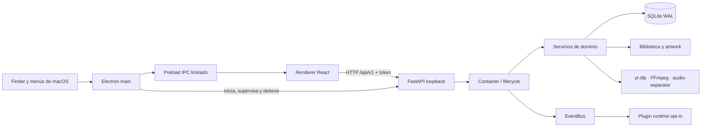

# Arquitectura de YT Ultimate

## Objetivo

YT Ultimate separa la experiencia de escritorio, la interfaz, el dominio y las
integraciones pesadas para que cada parte pueda evolucionar y probarse sin
convertir el backend en otro archivo monolítico. El proceso principal de
Electron es el coordinador; las reglas de biblioteca, descarga y procesamiento
pertenecen a servicios Python independientes.

## Límites por proceso

### Proceso principal de Electron

`frontend/electron/main.mjs` es dueño de la ventana y del ciclo de vida de la
aplicación. Configura CSP, deniega permisos web, limita navegación y enlaces,
registra asociaciones de archivos y coordina:

- `BackendController`: reserva puerto, crea token e identificador de instancia,
  inicia el sidecar, espera su health check, registra logs y termina el grupo de
  procesos.
- `AppMenuController`: construye menús macOS a partir del estado comunicado por
  el renderer.
- `registerDesktopIpc`: expone diálogos y operaciones nativas acotadas.

No hay reglas de biblioteca ni descarga en este proceso.

### Preload

`frontend/electron/preload.cjs` es la única frontera entre Electron y React.
Opera con `contextIsolation: true`, `nodeIntegration: false` y `sandbox: true`.
Expone un objeto inmutable de runtime y métodos IPC específicos; no expone
`ipcRenderer`, filesystem ni ejecución de procesos de forma genérica.

### Renderer React

`frontend/src/` contiene navegación, vistas y estado de reproducción. El
renderer:

- consume el backend mediante el cliente compartido `lib/api.js`;
- obtiene origen, puerto y token desde `lib/runtime.js`;
- mantiene sesión del reproductor, cola e historial en almacenamiento local;
- sincroniza reproducción con Media Session y el menú nativo;
- describe cada menú contextual una sola vez en `lib/contextMenu.js`: en macOS
  el proceso principal lo muestra como menú nativo y devuelve el elemento
  elegido; en Windows lo dibuja `ContextMenuHost` dentro de la página;
- traduce drag/drop y comandos de macOS a operaciones de dominio. Para sacar
  una canción como archivo cancela el drag HTML y deja que el proceso principal
  inicie el drag nativo con `webContents.startDrag`.

Los componentes no deben conocer rutas absolutas del usuario ni iniciar
subprocesos.

### Backend FastAPI

`backend/ytultimate/app.py` es una factoría de aplicación. Monta la API versionada,
middleware y handlers, mientras `container.py` crea y destruye explícitamente
las dependencias durante el lifespan de FastAPI.

Los routers de `ytultimate/api/routers/` validan transporte y delegan; no deben
implementar reglas de negocio. Los modelos HTTP viven en `api/models.py` y los
esquemas compartidos estrictos en `schemas.py`.

## Capas del backend

### Configuración de proceso

`AppConfig` es inmutable y se construye desde el entorno. Describe rutas,
binarios y red de la instancia; las preferencias modificables por el usuario se
guardan aparte mediante `SettingsService`.

Electron inyecta la configuración de una aplicación empaquetada. Para
diagnóstico o integración se reconocen:

| Variable | Responsabilidad |
| --- | --- |
| `YTU_HOST`, `YTU_PORT` | Bind del servicio; el host debe ser loopback. |
| `YTU_AUTH_TOKEN`, `YTU_INSTANCE_ID` | Autenticación e identidad efímera. |
| `YTU_DATA_DIR`, `YTU_CACHE_DIR`, `YTU_LOG_DIR` | Datos, caché y logs. |
| `YTU_LIBRARY_DIR`, `YTU_MODEL_DIR`, `YTU_PLUGIN_DIR` | Contenido administrado. |
| `YTU_DATABASE_PATH` | Archivo SQLite. |
| `YTU_RESOURCE_DIR` | Recursos incorporados al paquete. |
| `YTU_FFMPEG_PATH`, `YTU_FFPROBE_PATH`, `YTU_SEPARATOR_PATH` | Binarios explícitos. |
| `YTU_SEPARATOR_ARGS` | Lista JSON de argumentos previos al separador, p. ej. intérprete y `launcher.py --audio-separator`. |
| `YTU_EXIT_ON_STDIN_CLOSE` | Con `1`, el servicio se apaga de forma ordenada al cerrarse su entrada estándar. |
| `YTU_ALLOWED_ORIGINS` | Lista CORS separada por comas; `*` se descarta. |
| `YTU_DEVELOPER_MODE` | Override de proceso para el modo desarrollador. |

Las preferencias del usuario tienen esquema, valores predeterminados y
validación de tipo en `services/settings.py`.

### Container y ciclo de vida

`Container` es la raíz de composición. Su constructor no hace I/O. En `start()`:

1. crea directorios de aplicación;
2. abre y migra SQLite;
3. construye preferencias, eventos, media y biblioteca;
4. migra JSON legado o reconcilia la biblioteca;
5. crea el administrador acotado de trabajos;
6. conecta descarga, procesamiento y streaming;
7. inicia el runtime de plugins sólo si el modo desarrollador está activo.

En `shutdown()` primero descarga plugins, cancela trabajos, libera sesiones,
hace checkpoint y cierra SQLite. Esto mantiene propiedad y orden de limpieza
visibles.

### Servicios de dominio

| Servicio | Responsabilidad |
| --- | --- |
| `LibraryService` | Importar, indexar, reconciliar, resolver y eliminar media de forma segura. |
| `PlaylistService` | CRUD, membresía y orden de playlists. |
| `SettingsService` | Preferencias tipadas y persistentes. |
| `SearchService` | Búsqueda de fuentes remotas. |
| `DownloadService` | Descargas individuales o de playlist y registro del resultado. |
| `StreamingService` | Resolver streams remotos y servir proxy cuando corresponde. |
| `MediaTools` | Probing, conversión y utilidades FFmpeg/FFprobe. |
| `ProcessingService` | Separación de stems y fingerprint mediante trabajos. |
| `JobManager` | Ejecución acotada, snapshots, persistencia y cancelación. |

Los callbacks de servicios publican eventos a través del `EventBus`; no acoplan
la lógica principal a un plugin concreto.

### Persistencia

`Database` encapsula una conexión SQLite protegida por lock, con foreign keys,
WAL, migraciones versionadas y transacciones anidadas mediante savepoints.
Contiene:

- tracks administrados o referenciados;
- playlists y su orden;
- trabajos y estados;
- preferencias;
- estructura preparada para estado de plugins.

El runtime Plugin API v1 usa actualmente un `JsonStateStore` atómico en la
carpeta de plugins para elecciones de habilitación y configuración. El contrato
`StateStore` permite reemplazarlo por un adaptador de persistencia sin cambiar
el SDK.

## API local

Toda la API pública del desktop está bajo `/api/v1`.

| Área | Prefijo o rutas |
| --- | --- |
| Salud y rutas | `/system/health`, `/system/paths` |
| Preferencias | `/settings`, `/settings/schema`, `/settings/reset` |
| Biblioteca | `/library`, `/library/import`, tracks, artwork, stats y limpieza |
| Playlists | `/playlists` y membresías ordenadas |
| Descubrimiento | `/search`, `/playlist_info` |
| Descargas | `/downloads`, cancelación y limpieza |
| Reproducción remota | `/stream`, `/stream/proxy` |
| Procesamiento | `/separator/*`, `/fingerprint/*` |
| Plugins | `/developer/plugins/*` |

El documento OpenAPI se genera en `/api/v1/openapi.json`; las interfaces Swagger
y ReDoc están deshabilitadas en el servicio de escritorio.

### Contenido multimedia

Los archivos no se montan como un árbol estático. La biblioteca resuelve un
track por identificador, verifica que su ruta sea válida y lo entrega mediante
rutas de contenido o artwork. El streaming soporta peticiones `Range`, necesarias
para seek eficiente de audio y vídeo.

## Modelo de seguridad

### API de loopback

- El backend se niega a enlazar en una dirección que no sea loopback.
- Cada arranque de Electron usa un puerto disponible y un token aleatorio de 32
  bytes.
- `/api/v1/*` exige `X-YTU-Token`; recursos multimedia pueden recibir `token` en
  query porque los elementos HTML media no aceptan headers Axios.
- La comparación del token es constante, CORS usa allowlist y TrustedHost limita
  los hosts.
- El token es una credencial efímera: no debe registrarse en logs, URLs externas
  ni configuración persistente.

Esta protección separa la aplicación de otras páginas o procesos locales
accidentales. No pretende convertir una sesión de usuario macOS comprometida en
un entorno seguro.

### Desktop

- CSP limita scripts, conexiones, imágenes y media a los orígenes necesarios.
- Navegación y nuevas ventanas se bloquean; enlaces HTTP se delegan al navegador.
- Las solicitudes de permisos web se deniegan.
- IPC valida canales y payloads, y sólo permite carpetas conocidas.
- La aplicación usa hardened runtime y entitlements explícitos para releases.

### Plugins

Los plugins son Python in-process y tienen los permisos efectivos del backend.
El doble opt-in, los manifests, paths, timeouts y diagnósticos controlan
accidentes y visibilidad; no aíslan código hostil. Consulta
[Modo desarrollador](DEVELOPER_MODE.md).

## Trabajos y concurrencia

Las descargas y el procesamiento no bloquean el event loop HTTP. `JobManager`
usa un executor con capacidad limitada, estados canónicos y snapshots seguros.
La cancelación es cooperativa para funciones Python y termina los subprocesos que
el trabajo registre. Las preferencias limitan descargas y procesamiento
simultáneos.

Los estados canónicos son `pending`, `running`, `cancelling`, `completed`,
`failed` y `cancelled`. La capa de presentación conserva los nombres esperados
por la UI y mantiene `job_status` para no perder el estado real.

## Empaquetado

PyInstaller crea un bundle `onedir` con el backend y un alias del ejecutable para
`audio-separator`. Los scripts de staging copian ese bundle y los binarios
FFmpeg/FFprobe. electron-builder incorpora renderer, sidecars, modelo, SDK y
recursos del instalador dentro de la aplicación.

La aplicación empaquetada no depende de `backend/venv`; el entorno virtual sólo
se usa para desarrollo y para producir el sidecar.

En Windows el servicio no se congela: `resources/backend/python` contiene el
CPython embebible oficial con sus dependencias `win_amd64` y
`resources/backend/app` el código del backend. El archivo `._pth` define
`sys.path`, y Electron inicia `python.exe -I -O launcher.py`; el separador es el
mismo intérprete con `launcher.py --audio-separator`, configurado mediante
`YTU_SEPARATOR_PATH` y `YTU_SEPARATOR_ARGS`. Como Windows no entrega SIGTERM,
Electron cierra la entrada estándar para pedir el apagado y, si el proceso no
termina a tiempo, elimina su árbol con `taskkill`.

## Reglas de evolución

- Un endpoint nuevo empieza por un esquema de entrada/salida, un router delgado
  y un método de servicio probado.
- Un servicio recibe dependencias explícitas; no importa la aplicación FastAPI.
- Una integración pesada se ejecuta como trabajo y publica progreso/cancelación.
- Una capacidad nativa nueva usa un canal IPC concreto, nunca un bridge genérico.
- Una extensión de terceros usa la API pública versionada; no importa clases
  internas con prefijo `_`.
- Los cambios de persistencia se realizan mediante una migración incremental.
- El paquete sólo se construye después de la suite `test:headless`.
